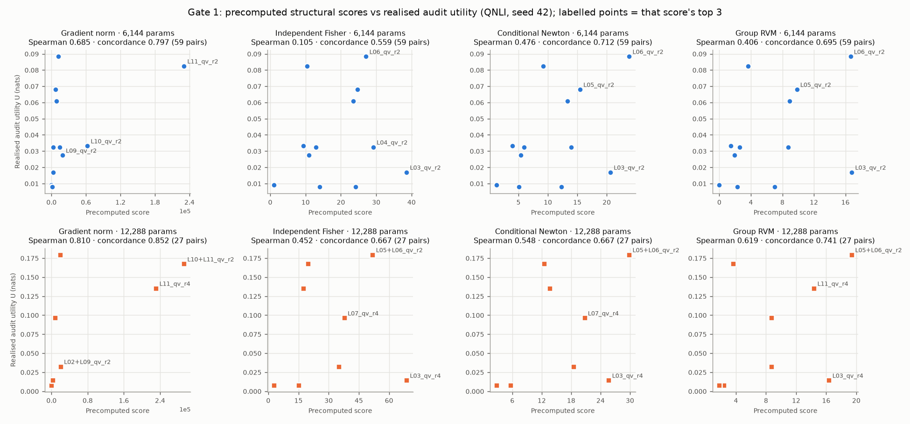
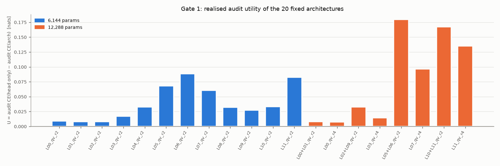

# RVM-LoRA pilot: final Go/No-Go assessment

**Date:** 2026-10-17T19:52:48+00:00 (UTC)  
**Overall decision (machine-evaluated, `reports/gates.json`):** **NO_GO**  
**Gate 0:** PASS · **Gate 1:** FAIL · **Gate 2:** NOT_RUN_GATE_FAILURE  
**Git SHA (report build):** `0f97833d68abb462ac620deaefe29368eb01cd35` · **Protocol freeze git SHA:** `7eb7092f02c05a7f7d90bf32f2d2b10a5f947559`  
**Protocol YAML SHA256:** `d242007e14950316549f7278cd7bdc2bd091bae577510ffdd5111b6bdf9b2b05` · **uv.lock SHA256:** `dd27a90b3e5e34e3bc11475da7a1b8ee41eeb871f9c3c26346cde36898cb38f5`  
**MLflow tracking URI:** remote-local `http://127.0.0.1:5000` (SQLite `mlruns/mlflow.db`, artifacts `mlruns/artifacts`), UI only through `ssh -N -L 15000:127.0.0.1:5000 <host>`  
**MLflow experiments:** `rvm-lora/gate0`, `rvm-lora/gate1`, `rvm-lora/gate2` (run IDs in `reports/run_index.csv` and below)

## Executive judgment

**No.** On the pre-registered QNLI architecture oracle, conditional group RVM evidence did not predict which LoRA structures help more than cheap scores, so the pilot stops at Gate 1 with a mechanical **NO_GO** (Gate 0 PASS, Gate 1 FAIL, Gate 2 NOT_RUN_GATE_FAILURE).

What passed: the implementation (46/46 Gate-0 tests; evidence identities to ~1e-13, real-model Jacobian vs JVP 2.7e-5), the null control (5/100 fresh nulls activated; RVM stopped at 6 of 24 rank units on real features) and the absolute concordance bar (RVM 0.709 ≥ 0.65 over 86 informative cost-matched pairs).

What failed, against valid measurements: (1) the **cheapest** score, the raw gradient norm ||b_A||², ranked architectures far better (concordance 0.814; RVM margin −0.105 vs the required +0.05); (2) RVM's six top-3 picks realised 0.0838 nats mean utility vs 0.0797 for gradient norm, a margin of +0.0041 < 0.005; (3) all three informative non-additivity effects had the wrong sign (0/3) — the evidence predicted redundancy where retraining showed synergy.

Relative to conditional Newton alone, RVM was marginally better on both diagnostics (+0.012 concordance, +0.0065 nats top-3), but the gate compares against the best cheap selector by design and that comparison is not close on concordance; moreover, Newton given the same null-calibrated stop selects RVM's exact structure. Exploratory diagnostics suggest why: realised 600-step utility tracks the raw sensitivity scale of a module (Spearman 0.69/0.90 with mean feature-column norm per stratum) while the evidence is invariant to per-module scale (the ARD precision absorbs it) and excluded value projections in 14 of 15 boundary cases. Gate 2 (quality, compression, overhead, EVA/OPLoRA comparisons) was therefore not run; no Gate-2 number exists. Recommendation: **stop**; do not scale this RVM selector.

## Experimental integrity and environment

| Evidence item | Value / hash | Verified? |
|---|---|---|
| Hardware GPU / VRAM / driver | NVIDIA RTX A4000, 16376 MiB, 595.71.05 | yes (`nvidia-smi`, torch) |
| OS / Python / torch / CUDA / Transformers / PEFT / MLflow | Ubuntu 26.04, kernel 7.0.0-15 / 3.11.17 / 2.14.1+cu130 / CUDA runtime 13.0 / 5.20.1 / 0.21.2 / 3.17.1; BF16 supported=True, BF16 fwd/bwd smoke=True | yes |
| Model ID and exact revision | `FacebookAI/roberta-base@e2da8e2f811d1448a5b465c236feacd80ffbac7b` | pinned in code |
| QNLI training/audit split hash | manifest `09cb486a77901636…`, adapter_train `880378c3ead20ded…`, audit `0d5f185a9e682abd…` | yes (tests) |
| SST2 training/audit split hash | manifest `dbd2d19ce993450f…`, adapter_train `b2dade8b65d6b8cb…`, audit `4303f6f54eea6c07…` | yes (tests) |
| Classifier-head checkpoint hashes per task/seed | qnli/42: `08d1ce5a251956c0…` | yes (hash re-checked on load) |
| Protocol freeze timestamp / git / YAML / MD | 2026-10-17T19:30:46+00:00 / `7eb7092f02c05a7f7d90bf32f2d2b10a5f947559` / `d242007e14950316…` / prereg `20aea8867ff1ae22…`, clarifications `52307892ade8f154…` | yes |
| Pilot run manager log and run index | `logs/pilot.log` (compact copy in bundle), `reports/run_index.csv` | yes |
| Evidence/calibration/official validation isolation | split tests (disjoint, train-only); audit read only after freeze and score precomputation; official validation read only in Gate 2 | yes |
| Parameter-count assertions, LoRA-only gradients | asserted per run (`assert_exact_layout`, head digest before/after training) | yes |
| Baseline fidelity and source commits | PEFT 0.21.2 EVA (native); OPLoRA = DPLoRA stage 1 `cjpark-ai/DPLoRA@6666d8bdb37ebd153a8916b0464c8a3878976aae` (MIT), exact ILP port | see C6 in `docs/PROTOCOL_CLARIFICATIONS.md` |

## Gate 0: numerical and pipeline correctness

| Required check | Tests | Measured | Status |
|---|---|---|---|
| gaussian_evidence_matches_direct | 2 | test_gradient_matches_finite_difference: max_abs_grad_err=4.215e-09; test_gram_evidence_matches_direct: E_at_upper_bound=1.776e-07, atol=1.000e-07, max_rel_err_evidence=8.348e-13, max_rel_err_increments=1.363e-13, rtol=0.000010 | **PASS** |
| singleton_analytic_solution | 1 | test_singleton_analytic_vs_numeric: cases=200, excluded_cases=95, max_abs_err=7.105e-15 | **PASS** |
| singleton_ranking_equivalence_q2_over_h | 1 | test_singleton_ranking_equals_q2_over_h: eligible_atoms=8, identical_ordering=True | **PASS** |
| conditional_group_evidence_equals_direct_difference | 2 | test_conditional_fixed_increment_equals_difference: max_rel_err=1.425e-13; test_degenerate_cases: duplicate_column_evidence=6.628950, zero_target_evidence=-6.152e-09 | **PASS** |
| selector_behaviour_and_null | 6 | test_null_behaviour: count=40, fresh_activations=1, threshold=0.001933; test_rvm_selects_signal_and_respects_constraints: selected_units=5, stop=null_threshold, threshold=0.001963 | **PASS** |
| logit_direction_jacobian_vs_jvp_fd | 3 | test_direction_gradient_matches_autograd: max_singular_value_err=5.551e-16; test_jacobian_matches_jvp_and_fd: columns=12, max_rel_err_vs_central_fd=3.064e-08, max_rel_err_vs_jvp=1.259e-15, threshold=0.001000 | **PASS** |
| exact_adapter_placement_and_param_counts | 5 | test_architecture_param_counts: q2_plus_v2=6144, q4_plus_v4=12288; test_uniform_budgets: B24=36864, B48=73728 | **PASS** |
| splits_disjoint_stable_no_validation | 4 | test_prepared_manifests_if_present: manifests_checked=['qnli', 'sst2']; test_split_sizes_disjoint_and_stable:  | **PASS** |
| gate_logic_and_reproducibility | 10 | pass/fail assertions | **PASS** |
| baselines_oplora_ilp_and_eva_budget | 3 | test_dp_matches_milp_full_size: cases=5, milp_assignment_agreement=5 | **PASS** |
| mlflow_idempotent_run_keys | 4 | test_mlflow_live_server: run_id=be7c1b31d6474a57afdaf51b97fe4518, uri=http://127.0.0.1:5000 | **PASS** |
| cuda_smoke_two_steps_frozen_head | 3 | test_eva_budget_and_init: eva_max_rank=2, eva_modules=20, eva_params=36864, eva_rank_sum=24; test_real_model_jacobian_vs_jvp: max_rel_err_real_model_vs_jvp=0.000027; test_two_step_train_eval: eval_loss_smoke=0.696471, peak_gpu_memory_mb=981.625977, precision=bfloat16, train_wall_2steps_s=0.684025 | **PASS** |

**Gate 0 determination:** PASS (46/46 tests; `artifacts/gate0/gate0.json`, MLflow run `64d3c655e3734196880c3ab5b26f74b2`). A first Gate-0 run (also 46/46) was superseded before the freeze because the live-MLflow test had silently exercised a temporary SQLite store (`mlflow.set_tracking_uri` mutates `MLFLOW_TRACKING_URI`); the test was fixed and Gate 0 re-run with a genuine live-server round trip. Both attempts are retained (`artifacts/gate0_attempt1_superseded/`).

## Gate 1: QNLI architecture oracle (20 full runs)

Each `U(A) = audit_CE(head only) − audit_CE(A)` uses the same frozen warm-started head (QNLI, seed 42) and the final 600-step checkpoint. All four scores were precomputed and logged (`artifacts/gate1/precomputed_scores.json`, MLflow probe run) before the first audit label was read.

Head-only audit CE: `0.690920654655885` nats.

| Architecture | Params | Grad norm | Indep. Fisher | Cond. Newton | Group RVM (log ev.) | Audit CE | Audit acc. | U (nats) | Status | MLflow run |
|---|---:|---:|---:|---:|---:|---:|---:|---:|---|---|
| L00_qv_r2 | 6,144 | 0.961 | 1.090 | 1.305 | -5.428e-10 | 0.68179 | 0.5880 | 0.00913 | COMPLETED | `e8552b59b1fb44f9b70b81ee6ef68ec7` |
| L01_qv_r2 | 6,144 | 263.737 | 13.994 | 5.069 | 2.296 | 0.68310 | 0.5713 | 0.00782 | COMPLETED | `6debd58a11d1462897d2a8fbd41e7199` |
| L02_qv_r2 | 6,144 | 1102.398 | 24.219 | 12.275 | 7.005 | 0.68305 | 0.5640 | 0.00787 | COMPLETED | `b5dbf3af72b0406aa2d3621c41e4c103` |
| L03_qv_r2 | 6,144 | 3263.488 | 38.592 | 20.621 | 16.805 | 0.67394 | 0.6393 | 0.01698 | COMPLETED | `076a19ee1a8249efa31e348a62013df9` |
| L04_qv_r2 | 6,144 | 3326.227 | 29.184 | 13.933 | 8.741 | 0.65845 | 0.7060 | 0.03247 | COMPLETED | `ceecd72cfc8249b6a1290914ed0cb10b` |
| L05_qv_r2 | 6,144 | 6873.944 | 24.727 | 15.463 | 9.839 | 0.62287 | 0.7280 | 0.06806 | COMPLETED | `c11a4ef9f4bd4d098270acad38c93530` |
| L06_qv_r2 | 6,144 | 12100.766 | 27.117 | 23.817 | 16.646 | 0.60253 | 0.7433 | 0.08839 | COMPLETED | `17298e1cd04146e8b203f389f0b58e9e` |
| L07_qv_r2 | 6,144 | 8336.252 | 23.550 | 13.309 | 8.935 | 0.63021 | 0.6413 | 0.06071 | COMPLETED | `0cb61aa3736d4f98ab3a76f0a8fb74f2` |
| L08_qv_r2 | 6,144 | 14596.510 | 12.988 | 5.972 | 2.602 | 0.65863 | 0.6520 | 0.03229 | COMPLETED | `35f5cce2c7ae49b781f0f23612794b30` |
| L09_qv_r2 | 6,144 | 19078.849 | 10.898 | 5.392 | 1.912 | 0.66349 | 0.6440 | 0.02743 | COMPLETED | `5ac63261b88e408dacb6857262897251` |
| L10_qv_r2 | 6,144 | 62383.100 | 9.343 | 3.992 | 1.437 | 0.65770 | 0.6680 | 0.03322 | COMPLETED | `d03800c52eae478480afcaaadb852a57` |
| L11_qv_r2 | 6,144 | 230388.080 | 10.425 | 9.226 | 3.653 | 0.60844 | 0.7213 | 0.08248 | COMPLETED | `3205a4bb03a44183af22c2d5b4335f3c` |
| L00+L01_qv_r2 | 12,288 | 264.698 | 15.085 | 5.624 | 2.384 | 0.68291 | 0.5687 | 0.00802 | COMPLETED | `90db6a4d0ee648fdbd2035c797b07da6` |
| L00_qv_r4 | 12,288 | 1.065 | 2.897 | 2.816 | 1.795 | 0.68317 | 0.5667 | 0.00775 | COMPLETED | `68082c49c1a349f19048cb64a185ba1e` |
| L02+L09_qv_r2 | 12,288 | 20181.247 | 35.117 | 18.479 | 8.704 | 0.65841 | 0.6493 | 0.03251 | COMPLETED | `f04d99b7b0cf438f84056a05cd223e98` |
| L03_qv_r4 | 12,288 | 3273.507 | 68.710 | 25.668 | 16.373 | 0.67654 | 0.6267 | 0.01438 | COMPLETED | `e41e2077aec04850ad2feefe43e83810` |
| L05+L06_qv_r2 | 12,288 | 18974.710 | 51.844 | 29.840 | 19.397 | 0.51144 | 0.7707 | 0.17948 | COMPLETED | `349a23538544496f88b284d4984b1e3e` |
| L07_qv_r4 | 12,288 | 8421.513 | 37.778 | 20.733 | 8.719 | 0.59457 | 0.7120 | 0.09636 | COMPLETED | `68d33c820447489687e70cc8465a682a` |
| L10+L11_qv_r2 | 12,288 | 292771.180 | 19.767 | 12.470 | 3.653 | 0.52358 | 0.7480 | 0.16734 | COMPLETED | `1dc549f174ac4d97a7478f4dc2b9c371` |
| L11_qv_r4 | 12,288 | 231109.010 | 17.533 | 13.606 | 14.379 | 0.55560 | 0.7340 | 0.13532 | COMPLETED | `3a6788bcaab94d64aa456271c4d4d1bd` |

Full-precision values: `reports/architecture_scores.csv`.

| Structural score | Pairwise concordance (concordant/informative) | Spearman 6,144 | Spearman 12,288 | Six-choice top-3 mean U | Margin vs best cheap (top-3) |
|---|---:|---:|---:|---:|---:|
| Gradient norm | 0.8140 (70/86) | 0.685 | 0.810 | 0.07972 | 0.00000 |
| Independent Fisher | 0.5930 (51/86) | 0.105 | 0.452 | 0.07134 | -0.00837 |
| Conditional Newton | 0.6977 (60/86) | 0.476 | 0.548 | 0.07727 | -0.00244 |
| Group RVM | 0.7093 (61/86) | 0.406 | 0.619 | 0.08377 | 0.00405 |

Top-3 choices per stratum: Gradient norm: 6,144 → L11_qv_r2, L10_qv_r2, L09_qv_r2; 12,288 → L10+L11_qv_r2, L11_qv_r4, L02+L09_qv_r2; Independent Fisher: 6,144 → L03_qv_r2, L04_qv_r2, L06_qv_r2; 12,288 → L03_qv_r4, L05+L06_qv_r2, L07_qv_r4; Conditional Newton: 6,144 → L06_qv_r2, L03_qv_r2, L05_qv_r2; 12,288 → L05+L06_qv_r2, L03_qv_r4, L07_qv_r4; Group RVM: 6,144 → L03_qv_r2, L06_qv_r2, L05_qv_r2; 12,288 → L05+L06_qv_r2, L03_qv_r4, L11_qv_r4

**Interaction non-additivity (not raw evidence increments):**

| Layer pair | Realised U(i,j)−U(i)−U(j), nats | Predicted E(i,j)−E(i)−E(j), log evidence | Informative? | Correct sign? |
|---|---:|---:|---|---|
| L00+L01_qv_r2 | -0.00894062801500295 | 0.08756809606318416 | True | False |
| L05+L06_qv_r2 | 0.023034657627567068 | -7.087963337748736 | True | False |
| L10+L11_qv_r2 | 0.05164092556033528 | -1.4368645403341302 | True | False |
| L02+L09_qv_r2 | -0.0027912997555203933 | -0.21285576598817912 | False | n/a |

**Stopping/null:** threshold (95th percentile of 100 calibration nulls, seed 1931) = `0.0013718244091873446` log-evidence nats per adapter parameter; fresh-null activations (seed 1932) = **5/100**; on the real QNLI features RVM selected 6 of 24 rank units (stop: null_threshold), ranks `{"roberta.encoder.layer.10.attention.self.value": 1, "roberta.encoder.layer.3.attention.self.query": 2, "roberta.encoder.layer.4.attention.self.query": 1, "roberta.encoder.layer.6.attention.self.query": 1, "roberta.encoder.layer.7.attention.self.value": 1}`.

**Gate-1 mandatory criteria** (thresholds from `configs/preregistered.yaml`):

| Criterion | Comparator | Cutoff | Actual (full precision) | Status |
|---|---|---|---|---|
| informative_cost_matched_pairs | >= | 30 | 86 | **PASS** |
| rvm_pairwise_concordance | >= | 0.65 | 0.7093023255813954 | **PASS** |
| rvm_concordance_minus_best_nonbayes | >= | 0.05 | -0.10465116279069764 | **FAIL** |
| rvm_six_choice_top3_utility_margin_nats | >= | 0.005 | 0.004051394741717146 | **FAIL** |
| fresh_null_activations | <= | 10 | 5 | **PASS** |
| nonadditivity_sign_correct | >= | 3 | 0 | **FAIL** |

**Gate 1: FAIL.** Criteria 1b, 2 and 4 FAIL; 1a and 3 PASS. The failure is not a near miss on concordance (−0.105 against +0.05). The top-3 margin is close to its cutoff (+0.00405 vs 0.005) and is reported at full precision without reinterpretation. Interaction rule: three informative effects (|I_oracle| > 0.005), zero correct signs. No score ties occurred among informative pairs, so the conservative tie rule did not affect any count.






## Gate 2: matched-budget comparisons

**Gate 2: NOT_RUN_GATE_FAILURE.** Gate 1 status FAIL; Gate 2 not run. Per the frozen conditional progression, none of the 24 Gate-2 trainings was started and the official GLUE validation splits were never evaluated. All 24 rows are listed with this status in `reports/run_index.csv`; no Gate-2 number is reported or imputed.

| Method | Mean QNLI CE | Mean SST-2 CE | Mean accuracy | Actual LoRA params | Mean selection s | Mean adapter-train s | Peak GB |
|---|---:|---:|---:|---:|---:|---:|---:|
| uniform_r1 | NOT_RUN_GATE_FAILURE | NOT_RUN_GATE_FAILURE | — | — | — | — | — |
| eva | NOT_RUN_GATE_FAILURE | NOT_RUN_GATE_FAILURE | — | — | — | — | — |
| oplora | NOT_RUN_GATE_FAILURE | NOT_RUN_GATE_FAILURE | — | — | — | — | — |
| conditional_newton | NOT_RUN_GATE_FAILURE | NOT_RUN_GATE_FAILURE | — | — | — | — | — |
| group_rvm | NOT_RUN_GATE_FAILURE | NOT_RUN_GATE_FAILURE | — | — | — | — | — |
| uniform_r2 | NOT_RUN_GATE_FAILURE | NOT_RUN_GATE_FAILURE | — | — | — | — | — |

## Failure analysis / critical ablations

| Probe | Selector | Rank units | Structure (module: rank) | Stop |
|---|---|---:|---|---|
| qnli_s42 | Group RVM | 6 | L3Q:2, L4Q:1, L6Q:1, L7V:1, L10V:1 | null_threshold |
| qnli_s42 | Conditional Newton (B24) | 24 | L0V:1, L2V:1, L3Q:2, L3V:1, L4Q:1, L6Q:5, L6V:2, L7Q:1, L7V:3, L9Q:3, L9V:2, L10V:1, L11V:1 | budget_exhausted |
| qnli_s42 | RVM no-logdet (offline ablation) | 6 | L3Q:2, L6Q:1, L6V:1, L11Q:2 | null_threshold |
| qnli_s42 | Newton with own null threshold (diagnostic) | 6 | L3Q:2, L4Q:1, L6Q:1, L7V:1, L10V:1 | threshold 0.0022763622904370616 |
| qnli_s42 | OPLoRA stage 1 | 24 | L2V:7, L10V:8, L11Q:1, L11V:8 | ILP |
| qnli_s42 | identity checks | — | RVM == Newton: False; no-logdet == Newton: False | λ = 0.01 |


All items below are **exploratory, post hoc** (`reports/exploratory_diagnostics.json`), computed on CPU from the frozen QNLI/42 probe and the logged Gate-1 results; none feeds a gate.

* **Logdet removed / RVM vs Newton allocation (offline):** on the real QNLI/42 features RVM stopped at 6 rank units (L3Q:2, L4Q:1, L6Q:1, L7V:1, L10V:1), while the pre-registered conditional Newton filled B24 (13 modules). That difference comes **entirely from stopping**: conditional Newton given its own null-calibrated threshold (diagnostic, same seeds and percentile) selects the **identical** 6-unit structure. So on these features the evidence's logdet/precision terms changed no selected module or rank relative to a null-thresholded ridge-quadratic selector; only the null-calibrated stop (which any selector can use) did. The no-logdet ablation (alpha at its lower bound, i.e. near-unregularised least squares, own threshold) also stopped at 6 units but chose a different set (L3Q:2, L6Q:1, L6V:1, L11Q:2), so the ridge/precision regularisation matters, not the Bayesian complexity term specifically. Whether a sparse 6-unit structure would compete at equal budget was not tested (Gate 2 not run).
* **Scale-invariance mismatch:** per stratum, Spearman(U, mean feature-column norm of the architecture) = 0.685 (6,144) / 0.905 (12,288) versus 0.182 / 0.452 for the summed scale-free strength q²/h. Value-projection columns have norms up to ~200 (layer 11) versus ~0.1–13 for queries, so ||b||² is dominated by deep value directions, which also realised large gains. Grouped-ARD evidence is invariant to rescaling a module's columns (α absorbs it); in the 20 full-architecture fits 15 modules were driven to the exclusion bound, 14 of them value projections (e.g. L11 value in L11_qv_r2, the second-best rank-2 architecture).
* **Interactions:** realised LoRA gains were super-additive for (5,6) and (10,11) (+0.023, +0.052 nats) and sub-additive for (0,1) (−0.0089). Both tangent-model scores predicted redundancy for (5,6) and (10,11) (RVM −7.09 / −1.44; conditional Newton −9.44 / −0.75), i.e. both were wrong on the two synergy pairs. On (0,1) RVM predicted a small positive effect (+0.088, wrong) while Newton predicted −0.75 (right), so Newton's signs would have scored 1/3 against RVM's 0/3 (Newton is not graded on this rule). The synergy misses are shared by the local Gauss–Newton surrogate rather than specific to the Bayesian part; the (0,1) miss is specific to the evidence. Gradient norm and independent Fisher are additive by construction (I = 0).
* **Sparsity / stopping:** the null control worked as designed (5/100; threshold 1.372e-3 nats per parameter, real first-step gain 5.70e-3). The posterior strongly favoured sparse support (6/24 units), but nothing in Gate 1 shows that this sparsity tracks retraining value.
* **Probe informativeness:** pseudo-response variance 0.996 (≈1 as the model assumes), no clipped probabilities, all 192 atoms non-zero, K eigenvalues 4.4e-6 to 7.1e4 (strongly ill-conditioned: correlated prefix atoms). Three optimiser `negative_optimum` events at ~1e-9 (exclusion of every module), no jitter needed in selection.
* **Head quality:** the protocol's 200-step frozen-backbone head is at chance on the audit set (accuracy 0.502, CE 0.69092 ≈ ln 2 = 0.69315). All U values therefore measure how much each adapter rescues a near-chance head; the realised U range (0.0078–0.179 nats) is wide enough for 86 informative pairs. The protocol was not altered.

## Resource accounting

- Completed main adapter trainings: 20 (Gate 1: 20, Gate 2: 0); summed 600-step training wall time 807.8 s = 0.224 GPU-hours (sequential, one GPU job at a time).
- Peak CUDA allocation across runs: 950 MB; training precision BF16 autocast, evaluation FP32 (TF32 disabled), selection linear algebra float64 on CPU.
- QNLI/42 head warm start: 5.9 s (excluded from the overhead ratio).
- OOM fallbacks: 0 runs used microbatch 4 × 8.
- QNLI/42 probe: direction pass 21.62 s, feature pass 2.90 s, OPLoRA importance pass 5.80 s, selection subprocess 7.88 s (start-up 0.43 s); RVM selection cost as charged 28.72 s, Newton 25.02 s, OPLoRA 5.81 s.


* Selection-cost decomposition (QNLI/42, informational only since Gate 2 did not run): the 21.6 s direction pass is most likely dominated by its 24 exact float64 768×768 SVDs on the A4000 (slow FP64). This is an inference, not a separate timer: the feature pass, which does comparable forward/backward work, takes 2.9 s. A CPU LAPACK alternative took 32 s for 24 such SVDs on this host (measured while a training run shared the CPU), so the frozen GPU path was kept unchanged. The 28.7 s charged to RVM would exceed 25% of the 27–54 s Gate-1 600-step training times, but no overhead criterion was evaluated.
* No OOM fallback, no failed or retried training run. GPU stopped after Gate 1 as required.
* Gate-1 peak CUDA allocation 950 MB (microbatch 8 × 4, BF16 training); all 20 runs completed on the first attempt.

## Deviations, missing evidence, and limitations

* **Protocol interpretations** fixed before any outcome: `docs/PROTOCOL_CLARIFICATIONS.md` (hash in the freeze). The only genuine document discrepancy (Newton budget vs null stopping, C1) was resolved in favour of the preregistration (Newton fills B24), the reading less favourable to RVM; it affects Gate 2 only.
* **Commits after the freeze (`7eb7092`):** `d57ac05` (selection-time accounting: exclude Gate-1 architecture scoring from the start-up share charged to RVM; committed and deployed before the first audit label was read; all 20 Gate-1 runs logged this SHA); `03b44b1` and later (report generator, post-hoc consistency tests, exploratory diagnostics, EVA total-wall double-count fix — no effect on any executed run or gate input). The first `all` invocation computed and wrote `gates.json`, then exited with code 1 because the report module was not yet deployed; the report was built afterwards with `cli report`, which re-evaluates gates from the same artifacts (`pytest -m post_hoc` verifies reproduction).
* `.gitignore` gained `artifacts/`; the shipped `SHA256SUMS.txt` line for `.gitignore` no longer matches (no protocol file changed; YAML and PREREGISTRATION hashes match the shipped sums).
* **Not executed:** all 24 Gate-2 runs (`NOT_RUN_GATE_FAILURE`), hence no official-validation evaluation, no EVA/OPLoRA training, no bootstrap, no overhead or specificity gate. EVA was integration-tested (real model, B24 respected: 36,864 params over 20 modules, max rank 2 on 128 direction rows); the OPLoRA stage-1 ILP port was unit-tested (DP = brute force = MILP) and its real QNLI/42 allocation was computed (L2V:7, L10V:8, L11Q:1, L11V:8), but neither was trained.
* **Limitations:** one task, one training seed and one head for Gate 1 (a screening signal, not a significance test); 20 architectures in two strata; pairwise comparisons are correlated; Gauss–Newton pseudo-evidence is not the exact nonlinear Transformer evidence and the greedy selector is not globally optimal; the head-only reference is at chance.

## Final decision and next experiment

**Machine-evaluated decision:** `NO_GO` (from `reports/gates.json`).  
**Scientific interpretation:** the pre-registered hypothesis that *Bayesian* conditional group evidence predicts useful LoRA capacity better than cheap structural scores is contradicted on its first, cheapest test. RVM does slightly outrank conditional Newton (and, with the same null-calibrated stop, Newton selects the identical structure), but the raw gradient norm beats both by a wide concordance margin, and the evidence's interaction signs are wrong (0/3). The likely mechanism (exploratory) is a mismatch between the scale-free, curvature-normalised local Gaussian evidence and what 600 steps of AdamW LoRA training actually exploit, together with the sub-additivity that any linear-Gaussian surrogate imposes on correlated directions.

**If NO-GO (this case):** the failed hypotheses are H1-ranking (concordance margin) and H1-interaction (non-additivity signs). More or different priors (hyperpriors, other precision bounds, other thresholds) would not fix this: the evidence is invariant to a module's scale for *any* per-module ARD prior, and the interaction sign comes from the shared tangent model, not from the prior. Re-tuning on these audit results is prohibited by the preregistration. Any follow-up (e.g. scale-aware or trajectory-based capacity criteria) would be a new, separately registered exploratory protocol, not a continuation of this one.

## Reproduction and evidence index

- `configs/preregistered.yaml` SHA256 `d242007e14950316549f7278cd7bdc2bd091bae577510ffdd5111b6bdf9b2b05`; `docs/PREREGISTRATION.md` SHA256 `20aea8867ff1ae22433fd33e1691cc39e60daffee2cd92b5110b1393eaad926f`; freeze record `reports/protocol_freeze.json`.
- MLflow run IDs: `reports/run_index.csv` (column `mlflow_run_id`) and the tables above.
- `reports/gates.json` (mechanical evaluator output), `reports/run_index.csv`, `reports/architecture_scores.csv`, `reports/gate1_summary.csv`, `reports/figures/`.
- Exact shell commands (fresh checkout on the GPU host):

```bash
bash scripts/bootstrap_remote.sh            # uv, Python 3.11, uv sync --frozen, dry run
bash scripts/start_mlflow.sh                # MLflow on 127.0.0.1:5000 in tmux 'rvm_mlflow'
export MLFLOW_TRACKING_URI=http://127.0.0.1:5000
uv run --frozen python -m rvm_lora.cli env-check
uv run --frozen pytest -q -m 'not post_hoc'
tmux new-session -d -s rvm_pilot 'bash scripts/run_remote.sh'   # full frozen gate chain
uv run --frozen python -m rvm_lora.cli status
uv run --frozen python -m rvm_lora.cli report   # gates.json, CSVs, figures, FINAL_REPORT.md, bundle
uv run --frozen pytest -q -m post_hoc           # gates.json reproducible from logged artifacts
```
- Review bundle: `reports/review_bundle.zip`; its SHA256 is in `reports/review_bundle.sha256` (the bundle contains this report, so the hash cannot be embedded here). Retrieve from the GPU host with `scp <user>@<host>:<REMOTE_PROJECT_DIR>/reports/review_bundle.zip .`

## Appendix: all planned main runs

| Gate | Method | Task | Seed | Architecture | Status | Params | Eval CE | MLflow run |
|---|---|---|---|---|---|---:|---:|---|
| gate1 | fixed_architecture | qnli | 42 | L00_qv_r2 | COMPLETED | 6,144 | 0.68179 | e8552b59b1fb44f9b70b81ee6ef68ec7 |
| gate1 | fixed_architecture | qnli | 42 | L01_qv_r2 | COMPLETED | 6,144 | 0.68310 | 6debd58a11d1462897d2a8fbd41e7199 |
| gate1 | fixed_architecture | qnli | 42 | L02_qv_r2 | COMPLETED | 6,144 | 0.68305 | b5dbf3af72b0406aa2d3621c41e4c103 |
| gate1 | fixed_architecture | qnli | 42 | L03_qv_r2 | COMPLETED | 6,144 | 0.67394 | 076a19ee1a8249efa31e348a62013df9 |
| gate1 | fixed_architecture | qnli | 42 | L04_qv_r2 | COMPLETED | 6,144 | 0.65845 | ceecd72cfc8249b6a1290914ed0cb10b |
| gate1 | fixed_architecture | qnli | 42 | L05_qv_r2 | COMPLETED | 6,144 | 0.62287 | c11a4ef9f4bd4d098270acad38c93530 |
| gate1 | fixed_architecture | qnli | 42 | L06_qv_r2 | COMPLETED | 6,144 | 0.60253 | 17298e1cd04146e8b203f389f0b58e9e |
| gate1 | fixed_architecture | qnli | 42 | L07_qv_r2 | COMPLETED | 6,144 | 0.63021 | 0cb61aa3736d4f98ab3a76f0a8fb74f2 |
| gate1 | fixed_architecture | qnli | 42 | L08_qv_r2 | COMPLETED | 6,144 | 0.65863 | 35f5cce2c7ae49b781f0f23612794b30 |
| gate1 | fixed_architecture | qnli | 42 | L09_qv_r2 | COMPLETED | 6,144 | 0.66349 | 5ac63261b88e408dacb6857262897251 |
| gate1 | fixed_architecture | qnli | 42 | L10_qv_r2 | COMPLETED | 6,144 | 0.65770 | d03800c52eae478480afcaaadb852a57 |
| gate1 | fixed_architecture | qnli | 42 | L11_qv_r2 | COMPLETED | 6,144 | 0.60844 | 3205a4bb03a44183af22c2d5b4335f3c |
| gate1 | fixed_architecture | qnli | 42 | L00_qv_r4 | COMPLETED | 12,288 | 0.68317 | 68082c49c1a349f19048cb64a185ba1e |
| gate1 | fixed_architecture | qnli | 42 | L03_qv_r4 | COMPLETED | 12,288 | 0.67654 | e41e2077aec04850ad2feefe43e83810 |
| gate1 | fixed_architecture | qnli | 42 | L07_qv_r4 | COMPLETED | 12,288 | 0.59457 | 68d33c820447489687e70cc8465a682a |
| gate1 | fixed_architecture | qnli | 42 | L11_qv_r4 | COMPLETED | 12,288 | 0.55560 | 3a6788bcaab94d64aa456271c4d4d1bd |
| gate1 | fixed_architecture | qnli | 42 | L00+L01_qv_r2 | COMPLETED | 12,288 | 0.68291 | 90db6a4d0ee648fdbd2035c797b07da6 |
| gate1 | fixed_architecture | qnli | 42 | L05+L06_qv_r2 | COMPLETED | 12,288 | 0.51144 | 349a23538544496f88b284d4984b1e3e |
| gate1 | fixed_architecture | qnli | 42 | L10+L11_qv_r2 | COMPLETED | 12,288 | 0.52358 | 1dc549f174ac4d97a7478f4dc2b9c371 |
| gate1 | fixed_architecture | qnli | 42 | L02+L09_qv_r2 | COMPLETED | 12,288 | 0.65841 | f04d99b7b0cf438f84056a05cd223e98 |
| gate2 | uniform_r1 | qnli | 42 | uniform_r1 | NOT_RUN_GATE_FAILURE | — | — | — |
| gate2 | eva | qnli | 42 | eva | NOT_RUN_GATE_FAILURE | — | — | — |
| gate2 | oplora | qnli | 42 | oplora | NOT_RUN_GATE_FAILURE | — | — | — |
| gate2 | conditional_newton | qnli | 42 | conditional_newton | NOT_RUN_GATE_FAILURE | — | — | — |
| gate2 | group_rvm | qnli | 42 | group_rvm | NOT_RUN_GATE_FAILURE | — | — | — |
| gate2 | uniform_r2 | qnli | 42 | uniform_r2 | NOT_RUN_GATE_FAILURE | — | — | — |
| gate2 | uniform_r1 | qnli | 2025 | uniform_r1 | NOT_RUN_GATE_FAILURE | — | — | — |
| gate2 | eva | qnli | 2025 | eva | NOT_RUN_GATE_FAILURE | — | — | — |
| gate2 | oplora | qnli | 2025 | oplora | NOT_RUN_GATE_FAILURE | — | — | — |
| gate2 | conditional_newton | qnli | 2025 | conditional_newton | NOT_RUN_GATE_FAILURE | — | — | — |
| gate2 | group_rvm | qnli | 2025 | group_rvm | NOT_RUN_GATE_FAILURE | — | — | — |
| gate2 | uniform_r2 | qnli | 2025 | uniform_r2 | NOT_RUN_GATE_FAILURE | — | — | — |
| gate2 | uniform_r1 | sst2 | 42 | uniform_r1 | NOT_RUN_GATE_FAILURE | — | — | — |
| gate2 | eva | sst2 | 42 | eva | NOT_RUN_GATE_FAILURE | — | — | — |
| gate2 | oplora | sst2 | 42 | oplora | NOT_RUN_GATE_FAILURE | — | — | — |
| gate2 | conditional_newton | sst2 | 42 | conditional_newton | NOT_RUN_GATE_FAILURE | — | — | — |
| gate2 | group_rvm | sst2 | 42 | group_rvm | NOT_RUN_GATE_FAILURE | — | — | — |
| gate2 | uniform_r2 | sst2 | 42 | uniform_r2 | NOT_RUN_GATE_FAILURE | — | — | — |
| gate2 | uniform_r1 | sst2 | 2025 | uniform_r1 | NOT_RUN_GATE_FAILURE | — | — | — |
| gate2 | eva | sst2 | 2025 | eva | NOT_RUN_GATE_FAILURE | — | — | — |
| gate2 | oplora | sst2 | 2025 | oplora | NOT_RUN_GATE_FAILURE | — | — | — |
| gate2 | conditional_newton | sst2 | 2025 | conditional_newton | NOT_RUN_GATE_FAILURE | — | — | — |
| gate2 | group_rvm | sst2 | 2025 | group_rvm | NOT_RUN_GATE_FAILURE | — | — | — |
| gate2 | uniform_r2 | sst2 | 2025 | uniform_r2 | NOT_RUN_GATE_FAILURE | — | — | — |
