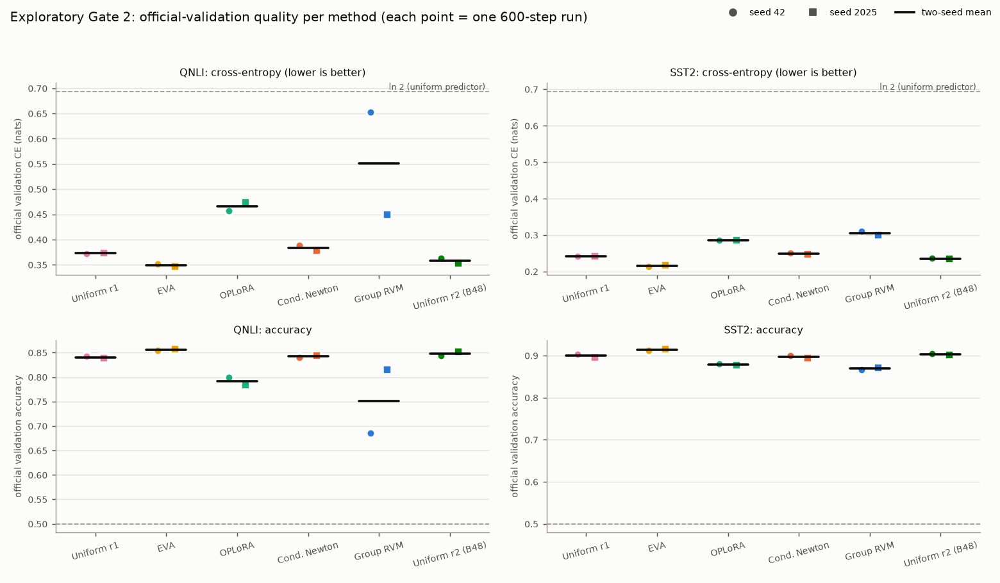
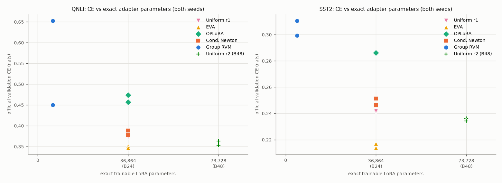
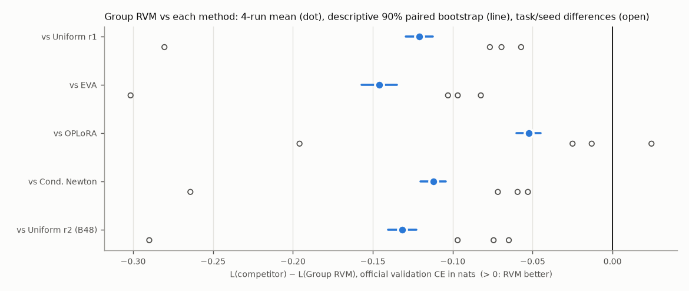
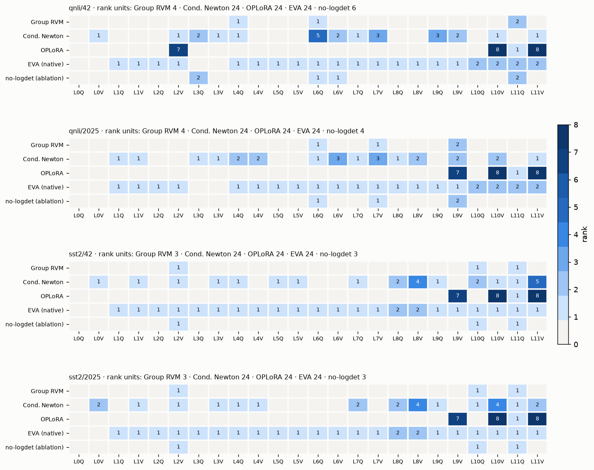
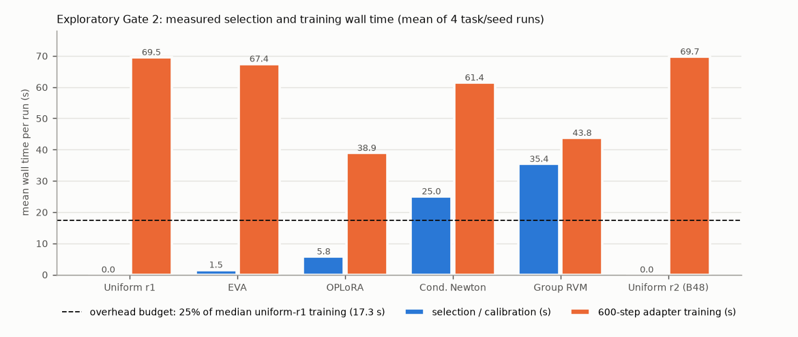

# RVM-LoRA pilot: exploratory Gate 2 under an explicit Gate-1 override

**Date:** 2026-10-18T07:57:00+00:00 (UTC) · **Namespace:** `gate2_exploratory` · **Execution type:** `exploratory_override`  
**Report build git SHA:** `471515f648f853a6456f90f1918408cebac00983` · **Training/selection code git SHA(s):** `1e19fbd39b1da36af169480b9858d2f2b912c4ad`  
**Protocol YAML SHA256:** `d242007e14950316549f7278cd7bdc2bd091bae577510ffdd5111b6bdf9b2b05` (unchanged; thresholds from `configs/preregistered.yaml`)

| Decision quantity | Value | Source |
|---|---|---|
| `preregistered_overall_decision` | **NO_GO** | `reports/v2/gates.json` (copied, not recomputed from exploratory results) |
| Preregistered Gate 0 / Gate 1 / Gate 2 | PASS / FAIL / NOT_RUN_GATE_FAILURE | same file |
| `exploratory_gate2_standalone_result` (counterfactual) | **FAIL** | `reports/gate2_exploratory/standalone_gate2.json`, `artifacts/gate2_exploratory/gate2/gate2_exploratory.json` |
| Counterfactual Route A / Route B | False / False | same |

> **Scope.** The user explicitly authorised running the frozen Gate-2 experiment despite the failed Gate 1, for this exploratory execution only. The 24 configurations, thresholds and code paths are the preregistered ones. The Gate-2 "result" below is a counterfactual: it says what the frozen Gate-2 criteria give when evaluated on their own. It does not count toward the preregistered Go/No-Go decision and cannot change it. Gate 1 remains FAIL and the project decision remains NO_GO.

## Executive summary (interpretation)

**The exploratory Gate 2 agrees with the preregistered decision: `NO_GO` stands.** All 24 frozen configurations completed with no failed run and no OOM fallback. They used the corrected v2 code under an explicitly authorised override of the Gate-1 prerequisite.

*Observed:*

* Group RVM has the highest official-validation cross-entropy of the six methods. Its 4-run mean is 0.4281 nats. The others: EVA 0.2821 (strongest B24 method), Uniform r2 at B48 0.2966, Uniform r1 0.3071, Conditional Newton 0.3160, OPLoRA 0.3757.
* RVM loses every task/seed comparison against Uniform r1, EVA, Newton and Uniform r2, and 3 of 4 against OPLoRA.
* Every 90% paired-bootstrap interval lies entirely on the unfavourable side of zero.
* Mean accuracy is 0.810 for RVM against 0.870 for Uniform r1 and 0.885 for EVA.

*Counterfactual gate:* the frozen Gate-2 rule, evaluated on its own, gives **FAIL**:

* Route A fails all three conditions, and so does Route B.
* The RVM-specificity condition fails in the unfavourable direction: RVM is 0.112 nats *worse* than Newton.
* The selection-overhead ratio is 0.512 against a limit of 0.25.
* Only baseline integrity passes.

*Interpretation:* RVM's null-calibrated stopping kept 3–4 rank units: 4,608–6,144 parameters, 12.5–16.7% of B24. That is real compression, but it costs 0.12 nats per example against Uniform r1 at the same budget. In three of four configurations, Newton stopped by its own null threshold and the no-logdet ablation select exactly the RVM structure. The sparsity therefore comes from the stopping rule, not from the Bayesian log-determinant. Two limitations from the audit remain open confounders:

* the weak frozen head (QNLI head-only audit accuracy 0.502);
* the mismatch between the gradient-SVD atoms RVM scores and the random zero-update subspace it trains.

Only a newly registered study could address them. Nothing here supports reconsidering `NO_GO`.

## Provenance, isolation and reproducibility

| Item | Value | Verified |
|---|---|---|
| Hardware | NVIDIA RTX A4000, 16376 MiB, 595.71.05 | `nvidia-smi` |
| Software | Python 3.11.17, torch 2.14.1+cu130 (CUDA 13.0), transformers 5.20.1, PEFT 0.21.2, MLflow 3.17.1, numpy 2.4.6, scipy 1.17.1; `uv sync --frozen`, uv.lock `dd27a90b3e5e34e3bc11475da7a1b8ee41eeb871f9c3c26346cde36898cb38f5` (equal to original freeze: True) | `reports/gate2_exploratory/environment.json` |
| Model / dataset revisions | `FacebookAI/roberta-base@e2da8e2f811d1448a5b465c236feacd80ffbac7b`, `nyu-mll/glue@bcdcba79d07bc864c1c254ccfcedcce55bcc9a8c` | pinned in code, logged as MLflow tags |
| Corrected implementation | training commit contains `4c54b1174b7501f7843407eaf042e8398ead6c2b` (`git merge-base --is-ancestor`, checked by `scripts/run_gate2_exploratory.sh` before any step). Versus the v2 freeze commit `d1aa145`: identical: `selectors.py`, `evidence.py`, `probe.py`, `selection_job.py`, `train.py`, `adapters.py`, `baselines.py`, `modeling.py`, `data.py`, `config.py`; changed: `pipeline.py`, `gates.py`, `tracking.py` (override, MLflow tags and Gate-2 refactor only; see `git diff d1aa145 1e19fbd`) | `git diff --quiet` per file |
| Protocol files | YAML, PREREGISTRATION, METHODS, PROTOCOL_CLARIFICATIONS hashes equal to the original freeze (else `freeze` refuses) | `reports/gate2_exploratory/protocol_freeze.json` |
| Split identities | manifests reused from `reports/splits/` (equal to the original freeze: True). Re-generated from the pinned GLUE train IDs with split seed 1729 and compared with the manifests, the encoded head/directions/evidence/adapter_train/audit files, and the IDs recorded by every head and probe here: qnli: all equal = **True**, validation rows 5463; sst2: all equal = **True**, validation rows 872. Validation IDs are identical across all 24 runs per task (asserted). | `standalone_gate2.json` → `split_identity` |
| Gate-0 suite on this commit | PASS (71/71 tests, incl. CUDA smoke and the new override regression tests), MLflow `b0ee11a29637455ba7457ebcd449d022` | `artifacts/gate2_exploratory/gate0/gate0.json` |
| Gate-1 record carried by the override | `artifacts/v2/gate1/gate1.json` status **FAIL**, SHA256 `fb79f4c6bd33c921ae2885a6becbf4037a352c0d951ae177f7fb7fa91e990d20` (read-only) | MLflow tags |
| v2 run untouched | 112 files under `artifacts/v2`, `checkpoints/v2`, `reports/v2`: 0 changed/missing, 0 added; 73 pre-existing MLflow runs: 0 changed; 35 runs added (this execution) → untouched: **True** | `artifacts/gate2_exploratory/integrity/v2_compare.json` |
| MLflow | experiment `rvm-lora/gate2`; every run tagged `stage=gate2`, `execution_type=exploratory_override`, `gate1_status=FAIL`, `protocol_version=v2_corrected`, `run_namespace=gate2_exploratory`, `git_sha`, `head_checkpoint_sha256`, `model_revision`, `dataset_revision`, `rank_allocation`; offline copy `reports/gate2_exploratory/mlflow_export.json` | tags |

**QNLI/42 reproduction of the corrected v2 head and probes.** The exploratory namespace rebuilt the QNLI/42 classifier head and probes from scratch. Nothing was copied from v2. Every item below must equal the v2 value, otherwise `train-b` stops before any training:

| Item | v2 reference | exploratory | Equal |
|---|---|---|---|
| qnli/42 conditional_newton_lambda | `0.01` | `0.01` | True |
| qnli/42 conditional_newton_ranks | `{"roberta.encoder.layer.0.attention.self.value": 1, "roberta.encoder.layer.10.attention.se` | `{"roberta.encoder.layer.0.attention.self.value": 1, "roberta.encoder.layer.10.attention.se` | True |
| qnli/42 group_rvm_fresh_null_activations | `5` | `5` | True |
| qnli/42 group_rvm_ranks | `{"roberta.encoder.layer.11.attention.self.query": 2, "roberta.encoder.layer.4.attention.se` | `{"roberta.encoder.layer.11.attention.self.query": 2, "roberta.encoder.layer.4.attention.se` | True |
| qnli/42 group_rvm_threshold | `0.0013718244091873446` | `0.0013718244091873446` | True |
| qnli/42 head_checkpoint_sha256 | `08d1ce5a251956c08cea8736d3dc04ffbd7c2d439d80d97a53c1213c2e598034` | `08d1ce5a251956c08cea8736d3dc04ffbd7c2d439d80d97a53c1213c2e598034` | True |
| qnli/42 head_examples | `2000` | `2000` | True |
| qnli/42 head_ids_sha256 | `55d2474dac5b61a20d543073dbe69cd213bcc5749b5f23ee0f80c1ed8e8b9821` | `55d2474dac5b61a20d543073dbe69cd213bcc5749b5f23ee0f80c1ed8e8b9821` | True |
| qnli/42 oplora_ranks | `{"roberta.encoder.layer.10.attention.self.value": 8, "roberta.encoder.layer.11.attention.s` | `{"roberta.encoder.layer.10.attention.self.value": 8, "roberta.encoder.layer.11.attention.s` | True |
| qnli/42 probe_Phi_sha256 | `b5cd954d9e1ce61224b5163bd36e0f7d8700a3b693f1ff110710d71d5bd49a1b` | `b5cd954d9e1ce61224b5163bd36e0f7d8700a3b693f1ff110710d71d5bd49a1b` | True |
| qnli/42 probe_atoms_sha256 | `3d360e4c87c8634d2b25c130a5902fbc2f89325a683d6769aae4791f2de808a7` | `3d360e4c87c8634d2b25c130a5902fbc2f89325a683d6769aae4791f2de808a7` | True |
| qnli/42 probe_directions_ids_sha256 | `eb01413968773c8b4fd2def13dcd4e0b144b8fc069762d64a3515ec86324a50e` | `eb01413968773c8b4fd2def13dcd4e0b144b8fc069762d64a3515ec86324a50e` | True |
| qnli/42 probe_evidence_ids_sha256 | `d7657b57d282032d4bc3771b0c1ed0c2871a83e1b9b34e0ee9ea545e1d950971` | `d7657b57d282032d4bc3771b0c1ed0c2871a83e1b9b34e0ee9ea545e1d950971` | True |
| qnli/42 probe_features_file_sha256 | `31be4fdae81c5383916a719f93367b68f87659322d68e604c184b3a49f404619` | `31be4fdae81c5383916a719f93367b68f87659322d68e604c184b3a49f404619` | True |
| qnli/42 probe_head_checkpoint_sha256 | `08d1ce5a251956c08cea8736d3dc04ffbd7c2d439d80d97a53c1213c2e598034` | `08d1ce5a251956c08cea8736d3dc04ffbd7c2d439d80d97a53c1213c2e598034` | True |
| qnli/42 probe_sizes | `{"directions": 512, "evidence": 512}` | `{"directions": 512, "evidence": 512}` | True |
| qnli/42 probe_t_sha256 | `fbc1921b63a95572b3e58c6a368490d9d1d98cc9aceddcbedf1c96e832bef38d` | `fbc1921b63a95572b3e58c6a368490d9d1d98cc9aceddcbedf1c96e832bef38d` | True |
| qnli/42 rvm_no_logdet_ranks | `{"roberta.encoder.layer.11.attention.self.query": 2, "roberta.encoder.layer.3.attention.se` | `{"roberta.encoder.layer.11.attention.self.query": 2, "roberta.encoder.layer.3.attention.se` | True |

The other configurations (qnli/2025, sst2/42, sst2/2025) have no v2 counterpart: Gate 2 never ran in v2. Their heads and probes were created here for the first time with the same code.

## A. Main results (observed)

Official GLUE validation (QNLI 5,463 rows, SST-2 872 rows); final 600-step checkpoint; binary cross-entropy in nats per example (float64). Seed-level values appear in brackets as `[seed 42; seed 2025]`.

| Method | Budget | QNLI CE mean [42; 2025] | QNLI acc mean [42; 2025] | SST-2 CE mean [42; 2025] | SST-2 acc mean [42; 2025] | 4-run mean CE | 4-run mean acc |
|---|---|---|---|---|---|---:|---:|
| Uniform r1 | B24 | 0.37268 [0.37246; 0.37291] | 0.8403 [0.8422; 0.8384] | 0.24157 [0.24109; 0.24204] | 0.8997 [0.9037; 0.8956] | 0.30712 | 0.8700 |
| EVA | B24 | 0.34898 [0.35127; 0.34669] | 0.8557 [0.8543; 0.8570] | 0.21530 [0.21375; 0.21685] | 0.9134 [0.9117; 0.9151] | 0.28214 | 0.8845 |
| OPLoRA | B24 | 0.46550 [0.45699; 0.47402] | 0.7914 [0.7994; 0.7835] | 0.28589 [0.28557; 0.28621] | 0.8790 [0.8807; 0.8773] | 0.37570 | 0.8352 |
| Cond. Newton | B24 | 0.38329 [0.38870; 0.37789] | 0.8424 [0.8406; 0.8442] | 0.24874 [0.25118; 0.24629] | 0.8968 [0.9002; 0.8933] | 0.31601 | 0.8696 |
| Group RVM | B24 | 0.55126 [0.65287; 0.44965] | 0.7507 [0.6857; 0.8157] | 0.30493 [0.31060; 0.29926] | 0.8693 [0.8670; 0.8716] | 0.42809 | 0.8100 |
| Uniform r2 (B48) | B48 | 0.35784 [0.36297; 0.35271] | 0.8483 [0.8442; 0.8523] | 0.23526 [0.23617; 0.23436] | 0.9031 [0.9048; 0.9014] | 0.29655 | 0.8757 |

**Ranking by 4-run mean CE (lower is better):** EVA (0.28214) < Uniform r2 (B48) (0.29655) < Uniform r1 (0.30712) < Cond. Newton (0.31601) < OPLoRA (0.37570) < Group RVM (0.42809)

**Per-run measurements** (full-precision CE in `results.csv`; selection = method-specific calibration, PROTOCOL_CLARIFICATIONS C5):

| Method | Task | Seed | CE | Acc. | Exact params | Rank units | Modules | Selection s | Train s | Total s | Peak GPU MB | Microbatch | MLflow run |
|---|---|---|---:|---:|---:|---:|---:|---:|---:|---:|---:|---|---|
| Uniform r1 | qnli | 42 | 0.37246 | 0.8422 | 36864 | 24 | 24 | 0.00 | 71.8 | 88.2 | 979 | 8×4 | `524406e66fd64daa9872371fc9d7fe71` |
| Uniform r1 | qnli | 2025 | 0.37291 | 0.8384 | 36864 | 24 | 24 | 0.00 | 68.1 | 84.3 | 979 | 8×4 | `79d2710cdc4e4ef59cb3e165108aae82` |
| Uniform r1 | sst2 | 42 | 0.24109 | 0.9037 | 36864 | 24 | 24 | 0.00 | 68.2 | 70.9 | 979 | 8×4 | `4e40f105f1974ffa98af4374b454483c` |
| Uniform r1 | sst2 | 2025 | 0.24204 | 0.8956 | 36864 | 24 | 24 | 0.00 | 70.1 | 72.9 | 979 | 8×4 | `74cd44d198934eae83c371276da1ebd2` |
| EVA | qnli | 42 | 0.35127 | 0.8543 | 36864 | 24 | 20 | 2.30 | 63.8 | 82.3 | 934 | 8×4 | `f6e014107d324ecd8681926b24622eb9` |
| EVA | qnli | 2025 | 0.34669 | 0.8570 | 36864 | 24 | 20 | 2.25 | 69.8 | 88.2 | 934 | 8×4 | `94db179e53a64156803958515e16ad9d` |
| EVA | sst2 | 42 | 0.21375 | 0.9117 | 36864 | 24 | 22 | 0.75 | 64.0 | 67.5 | 938 | 8×4 | `9f72ace85bd3446e9d516e004fde74ba` |
| EVA | sst2 | 2025 | 0.21685 | 0.9151 | 36864 | 24 | 22 | 0.77 | 72.2 | 75.8 | 938 | 8×4 | `6386c1f2a4d74cdcba3df526d0508e40` |
| OPLoRA | qnli | 42 | 0.45699 | 0.7994 | 36864 | 24 | 4 | 5.81 | 51.4 | 73.4 | 878 | 8×4 | `17550090ed0d486a9184bbe459b62934` |
| OPLoRA | qnli | 2025 | 0.47402 | 0.7835 | 36864 | 24 | 4 | 5.81 | 34.9 | 56.5 | 628 | 8×4 | `18d51ecbef02421db28065ab34b34b3a` |
| OPLoRA | sst2 | 42 | 0.28557 | 0.8807 | 36864 | 24 | 4 | 5.77 | 33.0 | 41.4 | 628 | 8×4 | `b91142e5edb643e68fa0d40515d85620` |
| OPLoRA | sst2 | 2025 | 0.28621 | 0.8773 | 36864 | 24 | 4 | 5.76 | 36.4 | 44.8 | 628 | 8×4 | `9483cd2861784ab0bbf4c23f8c5f3be9` |
| Cond. Newton | qnli | 42 | 0.38870 | 0.8406 | 36864 | 24 | 13 | 25.31 | 64.6 | 106.0 | 961 | 8×4 | `d1fdf38cbd254b6cb270b11882d1bce9` |
| Cond. Newton | qnli | 2025 | 0.37789 | 0.8442 | 36864 | 24 | 15 | 24.83 | 58.9 | 99.8 | 928 | 8×4 | `c2ffb336195d45f5b824eed3c63af8b1` |
| Cond. Newton | sst2 | 42 | 0.25118 | 0.9002 | 36864 | 24 | 15 | 24.95 | 59.4 | 87.1 | 964 | 8×4 | `e949708570974661a9d135312be74b83` |
| Cond. Newton | sst2 | 2025 | 0.24629 | 0.8933 | 36864 | 24 | 14 | 25.03 | 62.9 | 91.1 | 964 | 8×4 | `85d60fb4bef149f3843291fea606960d` |
| Group RVM | qnli | 42 | 0.65287 | 0.6857 | 6144 | 4 | 3 | 36.07 | 40.6 | 92.5 | 804 | 8×4 | `ce38b646b7f345d6a68d857bde8603b0` |
| Group RVM | qnli | 2025 | 0.44965 | 0.8157 | 6144 | 4 | 3 | 35.34 | 38.2 | 89.4 | 734 | 8×4 | `e7d35f0527754ac9b3ee17a9bc2c8968` |
| Group RVM | sst2 | 42 | 0.31060 | 0.8670 | 4608 | 3 | 3 | 35.00 | 50.2 | 87.8 | 877 | 8×4 | `f3b44f9a64b8418d9e063a1bb293882b` |
| Group RVM | sst2 | 2025 | 0.29926 | 0.8716 | 4608 | 3 | 3 | 35.20 | 46.0 | 83.9 | 877 | 8×4 | `b532e975a1b34c729d7842863d61d633` |
| Uniform r2 (B48) | qnli | 42 | 0.36297 | 0.8442 | 73728 | 48 | 24 | 0.00 | 71.1 | 87.4 | 979 | 8×4 | `28632f9e667545778a977db10610b83d` |
| Uniform r2 (B48) | qnli | 2025 | 0.35271 | 0.8523 | 73728 | 48 | 24 | 0.00 | 72.5 | 88.8 | 979 | 8×4 | `31acd68f9c4b4b9eb80aefd463fb2417` |
| Uniform r2 (B48) | sst2 | 42 | 0.23617 | 0.9048 | 73728 | 48 | 24 | 0.00 | 66.0 | 68.8 | 979 | 8×4 | `16b9be0baf1d41929fd8236fccf3e99a` |
| Uniform r2 (B48) | sst2 | 2025 | 0.23436 | 0.9014 | 73728 | 48 | 24 | 0.00 | 69.4 | 72.2 | 979 | 8×4 | `42ee7338f31b4dfabc73413fcaf1537b` |

**Rank allocations actually trained** (exact JSON in `results.csv` column `ranks_json` and MLflow tag `rank_allocation`):

| Method | Task/seed | Rank units | Allocation |
|---|---|---:|---|
| Uniform r1 | qnli/42 | 24 | all 24 modules × r1 |
| Uniform r1 | qnli/2025 | 24 | all 24 modules × r1 |
| Uniform r1 | sst2/42 | 24 | all 24 modules × r1 |
| Uniform r1 | sst2/2025 | 24 | all 24 modules × r1 |
| EVA | qnli/42 | 24 | L1Q:1, L1V:1, L2Q:1, L2V:1, L4Q:1, L4V:1, L5Q:1, L5V:1, L6Q:1, L6V:1, L7Q:1, L7V:1, L8Q:1, L8V:1, L9Q:1, L9V:1, L10Q:2, L10V:2, L11Q:2, L11V:2 |
| EVA | qnli/2025 | 24 | L1Q:1, L1V:1, L2Q:1, L2V:1, L4Q:1, L4V:1, L5Q:1, L5V:1, L6Q:1, L6V:1, L7Q:1, L7V:1, L8Q:1, L8V:1, L9Q:1, L9V:1, L10Q:2, L10V:2, L11Q:2, L11V:2 |
| EVA | sst2/42 | 24 | L1Q:1, L1V:1, L2Q:1, L2V:1, L3Q:1, L3V:1, L4Q:1, L4V:1, L5Q:1, L5V:1, L6Q:1, L6V:1, L7Q:1, L7V:1, L8Q:2, L8V:2, L9Q:1, L9V:1, L10Q:1, L10V:1, L11Q:1, L11V:1 |
| EVA | sst2/2025 | 24 | L1Q:1, L1V:1, L2Q:1, L2V:1, L3Q:1, L3V:1, L4Q:1, L4V:1, L5Q:1, L5V:1, L6Q:1, L6V:1, L7Q:1, L7V:1, L8Q:2, L8V:2, L9Q:1, L9V:1, L10Q:1, L10V:1, L11Q:1, L11V:1 |
| OPLoRA | qnli/42 | 24 | L2V:7, L10V:8, L11Q:1, L11V:8 |
| OPLoRA | qnli/2025 | 24 | L9V:7, L10V:8, L11Q:1, L11V:8 |
| OPLoRA | sst2/42 | 24 | L9V:7, L10V:8, L11Q:1, L11V:8 |
| OPLoRA | sst2/2025 | 24 | L9V:7, L10V:8, L11Q:1, L11V:8 |
| Cond. Newton | qnli/42 | 24 | L0V:1, L2V:1, L3Q:2, L3V:1, L4Q:1, L6Q:5, L6V:2, L7Q:1, L7V:3, L9Q:3, L9V:2, L10V:1, L11V:1 |
| Cond. Newton | qnli/2025 | 24 | L1Q:1, L1V:1, L3Q:1, L3V:1, L4Q:2, L4V:2, L6Q:1, L6V:3, L7Q:1, L7V:3, L8Q:1, L8V:2, L9V:2, L10V:2, L11V:1 |
| Cond. Newton | sst2/42 | 24 | L0V:1, L1V:1, L2V:1, L3V:1, L4Q:1, L5Q:1, L5V:1, L7Q:1, L8Q:2, L8V:4, L9Q:1, L10Q:2, L10V:1, L11Q:1, L11V:5 |
| Cond. Newton | sst2/2025 | 24 | L0V:2, L1V:1, L2V:1, L3V:1, L4Q:1, L4V:1, L7Q:2, L8Q:2, L8V:4, L9Q:1, L10Q:1, L10V:4, L11Q:1, L11V:2 |
| Group RVM | qnli/42 | 4 | L4Q:1, L6Q:1, L11Q:2 |
| Group RVM | qnli/2025 | 4 | L6Q:1, L7V:1, L9V:2 |
| Group RVM | sst2/42 | 3 | L2V:1, L10Q:1, L11Q:1 |
| Group RVM | sst2/2025 | 3 | L2V:1, L10Q:1, L11Q:1 |
| Uniform r2 (B48) | qnli/42 | 48 | all 24 modules × r2 |
| Uniform r2 (B48) | qnli/2025 | 48 | all 24 modules × r2 |
| Uniform r2 (B48) | sst2/42 | 48 | all 24 modules × r2 |
| Uniform r2 (B48) | sst2/2025 | 48 | all 24 modules × r2 |





*Observed:*

* **Method ordering.** By two-seed mean CE the ordering is identical on both tasks: EVA < Uniform r2 (B48) < Uniform r1 < Conditional Newton < OPLoRA < Group RVM. EVA has the lowest CE in all four task/seed configurations. At B24 it is also below Uniform r2, which uses twice the parameters (0.2821 vs 0.2966).
* **Uniform rank.** Doubling uniform rank from 1 to 2 lowers mean CE by only 0.0106 nats.
* **Seed variation.** Seed-to-seed spread is at most 0.017 nats for every method except Group RVM. RVM's two QNLI seeds selected different structures and differ by 0.203 nats: CE 0.6529 vs 0.4497, accuracy 0.686 vs 0.816.
* **EVA's native initialisation.** EVA keeps its native, data-driven initialisation, as preregistered. Its allocation is close to uniform: rank 1–2 on 20–22 modules. Its 0.025-nat advantage over Uniform r1 therefore cannot be attributed to allocation alone, and this design cannot separate the two.

## B. Matched-budget comparisons (observed)

Each row compares Group RVM (B24, ≤36,864 parameters) with one method under the same budget, head, data order, seeds and evaluation. The difference is `L(method) − L(RVM)`, so positive values mean RVM has lower CE. The 90% interval uses the frozen Gate-2 procedure: stratified paired-example bootstrap, 2,000 resamples, seed 991, the same indices for both seeds within a task. For the post-hoc strongest B24 competitor it is a Gate-2 criterion. For every other row it is **descriptive only**.

| RVM vs | Budget | L(method) | L(RVM) | L(method) − L(RVM) | QNLI mean diff | SST-2 mean diff | RVM wins (of 4) | 90% paired bootstrap [5%, 95%] | Acc(RVM) − Acc(method) |
|---|---|---:|---:|---:|---:|---:|---:|---|---:|
| Uniform r1 | B24 | 0.30712 | 0.42809 | -0.12097 | -0.17858 | -0.06336 | 0 | [-0.12950, -0.11258] | -0.0600 |
| EVA **(gate criterion: strongest B24)** | B24 | 0.28214 | 0.42809 | -0.14596 | -0.20228 | -0.08963 | 0 | [-0.15714, -0.13497] | -0.0746 |
| OPLoRA | B24 | 0.37570 | 0.42809 | -0.05240 | -0.08576 | -0.01904 | 1 | [-0.06005, -0.04488] | -0.0252 |
| Cond. Newton | B24 | 0.31601 | 0.42809 | -0.11208 | -0.16797 | -0.05619 | 0 | [-0.12007, -0.10424] | -0.0596 |
| Uniform r2 (B48) | B48 | 0.29655 | 0.42809 | -0.13154 | -0.19342 | -0.06966 | 0 | [-0.14049, -0.12278] | -0.0657 |

Per task/seed CE differences `L(method) − L(RVM)` (full precision in `standalone_gate2.json`):

| RVM vs | qnli/42 | qnli/2025 | sst2/42 | sst2/2025 |
|---|---:|---:|---:|---:|
| Uniform r1 | -0.28041 | -0.07675 | -0.06951 | -0.05722 |
| EVA | -0.30160 | -0.10297 | -0.09685 | -0.08241 |
| OPLoRA | -0.19587 | +0.02436 | -0.02503 | -0.01305 |
| Cond. Newton | -0.26417 | -0.07177 | -0.05942 | -0.05296 |
| Uniform r2 (B48) | -0.28990 | -0.09694 | -0.07443 | -0.06490 |



*Observed:* The post-hoc strongest B24 competitor is EVA. RVM's mean CE difference against each method, with the 90% paired bootstrap and the number of task/seed comparisons RVM wins:

| RVM vs | Mean difference | 90% bootstrap | RVM wins |
|---|---:|---|---:|
| EVA | −0.1460 | [−0.1571, −0.1350] | 0/4 |
| Uniform r1 | −0.1210 | [−0.1295, −0.1126] | 0/4 |
| Conditional Newton | −0.1121 | [−0.1201, −0.1042] | 0/4 |
| OPLoRA | −0.0524 | [−0.0601, −0.0449] | 1/4 (QNLI/2025, +0.0244) |
| Uniform r2 (B48) | −0.1315 | [−0.1405, −0.1228] | 0/4 |

* **By task.** The deficit against the four strongest methods is larger on QNLI (−0.168 to −0.202) than on SST-2 (−0.056 to −0.090).
* **Accuracy.** RVM's accuracy is 2.5 points (vs OPLoRA) to 7.5 points (vs EVA) below.
* **Highlight.** The best B24 method is EVA; the best method overall is EVA at B24, ahead of Uniform r2 at B48.
* **No favourable comparison.** No comparison favours RVM at either budget.

Only the interval against EVA is a gate criterion; the others are descriptive. All of them condition on the two training seeds and are not population-of-seeds intervals.

## C. Structural analysis (observed)

Layer-by-layer ranks as `query/value` per layer. RVM, Newton and OPLoRA allocations come from the probe stage before training. EVA's ranks are its native explained-variance allocation, read from the trained model. The no-logdet column is an offline structural ablation and was **not trained**.

**qnli/42** (rank units: RVM 4, Newton 24, OPLoRA 24, EVA 24, no-logdet† 6)

| Layer | RVM | Newton | OPLoRA | EVA | no-logdet† |
|---|---:|---:|---:|---:|---:|
| L0 | 0/0 | 0/1 | 0/0 | 0/0 | 0/0 |
| L1 | 0/0 | 0/0 | 0/0 | 1/1 | 0/0 |
| L2 | 0/0 | 0/1 | 0/7 | 1/1 | 0/0 |
| L3 | 0/0 | 2/1 | 0/0 | 0/0 | 2/0 |
| L4 | 1/0 | 1/0 | 0/0 | 1/1 | 0/0 |
| L5 | 0/0 | 0/0 | 0/0 | 1/1 | 0/0 |
| L6 | 1/0 | 5/2 | 0/0 | 1/1 | 1/1 |
| L7 | 0/0 | 1/3 | 0/0 | 1/1 | 0/0 |
| L8 | 0/0 | 0/0 | 0/0 | 1/1 | 0/0 |
| L9 | 0/0 | 3/2 | 0/0 | 1/1 | 0/0 |
| L10 | 0/0 | 0/1 | 0/8 | 2/2 | 0/0 |
| L11 | 2/0 | 0/1 | 1/8 | 2/2 | 2/0 |

**qnli/2025** (rank units: RVM 4, Newton 24, OPLoRA 24, EVA 24, no-logdet† 4)

| Layer | RVM | Newton | OPLoRA | EVA | no-logdet† |
|---|---:|---:|---:|---:|---:|
| L0 | 0/0 | 0/0 | 0/0 | 0/0 | 0/0 |
| L1 | 0/0 | 1/1 | 0/0 | 1/1 | 0/0 |
| L2 | 0/0 | 0/0 | 0/0 | 1/1 | 0/0 |
| L3 | 0/0 | 1/1 | 0/0 | 0/0 | 0/0 |
| L4 | 0/0 | 2/2 | 0/0 | 1/1 | 0/0 |
| L5 | 0/0 | 0/0 | 0/0 | 1/1 | 0/0 |
| L6 | 1/0 | 1/3 | 0/0 | 1/1 | 1/0 |
| L7 | 0/1 | 1/3 | 0/0 | 1/1 | 0/1 |
| L8 | 0/0 | 1/2 | 0/0 | 1/1 | 0/0 |
| L9 | 0/2 | 0/2 | 0/7 | 1/1 | 0/2 |
| L10 | 0/0 | 0/2 | 0/8 | 2/2 | 0/0 |
| L11 | 0/0 | 0/1 | 1/8 | 2/2 | 0/0 |

**sst2/42** (rank units: RVM 3, Newton 24, OPLoRA 24, EVA 24, no-logdet† 3)

| Layer | RVM | Newton | OPLoRA | EVA | no-logdet† |
|---|---:|---:|---:|---:|---:|
| L0 | 0/0 | 0/1 | 0/0 | 0/0 | 0/0 |
| L1 | 0/0 | 0/1 | 0/0 | 1/1 | 0/0 |
| L2 | 0/1 | 0/1 | 0/0 | 1/1 | 0/1 |
| L3 | 0/0 | 0/1 | 0/0 | 1/1 | 0/0 |
| L4 | 0/0 | 1/0 | 0/0 | 1/1 | 0/0 |
| L5 | 0/0 | 1/1 | 0/0 | 1/1 | 0/0 |
| L6 | 0/0 | 0/0 | 0/0 | 1/1 | 0/0 |
| L7 | 0/0 | 1/0 | 0/0 | 1/1 | 0/0 |
| L8 | 0/0 | 2/4 | 0/0 | 2/2 | 0/0 |
| L9 | 0/0 | 1/0 | 0/7 | 1/1 | 0/0 |
| L10 | 1/0 | 2/1 | 0/8 | 1/1 | 1/0 |
| L11 | 1/0 | 1/5 | 1/8 | 1/1 | 1/0 |

**sst2/2025** (rank units: RVM 3, Newton 24, OPLoRA 24, EVA 24, no-logdet† 3)

| Layer | RVM | Newton | OPLoRA | EVA | no-logdet† |
|---|---:|---:|---:|---:|---:|
| L0 | 0/0 | 0/2 | 0/0 | 0/0 | 0/0 |
| L1 | 0/0 | 0/1 | 0/0 | 1/1 | 0/0 |
| L2 | 0/1 | 0/1 | 0/0 | 1/1 | 0/1 |
| L3 | 0/0 | 0/1 | 0/0 | 1/1 | 0/0 |
| L4 | 0/0 | 1/1 | 0/0 | 1/1 | 0/0 |
| L5 | 0/0 | 0/0 | 0/0 | 1/1 | 0/0 |
| L6 | 0/0 | 0/0 | 0/0 | 1/1 | 0/0 |
| L7 | 0/0 | 2/0 | 0/0 | 1/1 | 0/0 |
| L8 | 0/0 | 2/4 | 0/0 | 2/2 | 0/0 |
| L9 | 0/0 | 1/0 | 0/7 | 1/1 | 0/0 |
| L10 | 1/0 | 1/4 | 0/8 | 1/1 | 1/0 |
| L11 | 1/0 | 1/2 | 1/8 | 1/1 | 1/0 |

**Sparsity and stopping per configuration:**

Parameter reduction of RVM: exact RVM parameters relative to Uniform r2 (B48, 73,728) and to the B24 budget (36,864): qnli/42 6,144 = 8.3% of B48, 16.7% of B24; qnli/2025 6,144 = 8.3% of B48, 16.7% of B24; sst2/42 4,608 = 6.2% of B48, 12.5% of B24; sst2/2025 4,608 = 6.2% of B48, 12.5% of B24.

| Task/seed | RVM rank units (params) | RVM stop reason | RVM threshold (nats/param) | Fresh-null activations (diagnostic) | RVM == Newton? | Newton-with-own-threshold units (diagnostic) | CE RVM | CE Uniform r1 | CE Newton |
|---|---|---|---:|---:|---|---:|---:|---:|---:|
| qnli/42 | 4 (6144) | null_threshold | 0.0013718244091873446 | 5/100 | False | 6 | 0.65287 | 0.37246 | 0.38870 |
| qnli/2025 | 4 (6144) | null_threshold | 0.0021121285177668776 | 3/100 | False | 4 | 0.44965 | 0.37291 | 0.37789 |
| sst2/42 | 3 (4608) | null_threshold | 0.0017205267610994283 | 1/100 | False | 3 | 0.31060 | 0.24109 | 0.25118 |
| sst2/2025 | 3 (4608) | null_threshold | 0.0016665668058235218 | 0/100 | False | 3 | 0.29926 | 0.24204 | 0.24629 |



*Observed:*

* **RVM.** In all four configurations RVM stopped at its calibrated null threshold after 3–4 rank units on 3 modules:
  * QNLI/42: L4Q:1, L6Q:1, L11Q:2 (query projections only).
  * QNLI/2025: L6Q:1, L7V:1, L9V:2.
  * SST-2/42 and SST-2/2025 (identical): L2V:1, L10Q:1, L11Q:1.
* **Newton (B24).** Spreads 24 units over 13–15 modules.
* **EVA.** Spreads 24 units over 20–22 modules at rank 1–2. It drops layer 0 everywhere and layer 3 on QNLI.
* **OPLoRA.** Puts 23 of 24 units into three value projections at rank 7–8, plus L11Q:1.
* **Diagnostics.** In QNLI/2025, SST-2/42 and SST-2/2025, the RVM structure is identical to the no-logdet ablation and to Newton stopped by its own null threshold. Only QNLI/42 differs: RVM selects 4 units, each diagnostic 6.

*Interpretation: does the extreme sparsity help or hurt?* It hurts:

* **Against Newton.** Newton uses the same features, dictionary and candidate groups and fills B24. It beats the sparse RVM structure by 0.112 nats on average and in all four configurations. That deficit is about ten times the Uniform r1 → r2 gain.
* **Source of the sparsity.** The thresholded-Newton and no-logdet diagnostics reproduce the RVM structure in 3 of 4 configurations. The early stop therefore comes from the null-calibrated stopping rule, not from the Bayesian precision or log-determinant.
* **Breadth vs concentration.** The two concentrated allocations, OPLoRA (4 modules) and RVM (3 modules), are the two worst. The broad allocations (EVA, Uniform r2, Uniform r1, Newton) all lie within 0.034 nats of one another.
* **Single observations, not established effects.** The worst RVM run, QNLI/42 (CE 0.653, accuracy 0.686), is its only query-only structure. For context only, on a different evaluation set: in v2 Gate 1, on the same QNLI/42 head, the better fixed single-layer q+v rank-2 architectures with the same 6,144 parameters reached audit CE 0.60–0.63.

## D. Computational efficiency (observed)

| Method | Mean selection s | Mean train s | Mean total s | Selection / median Uniform-r1 train | Mean exact params | Peak GPU MB (max) |
|---|---:|---:|---:|---:|---:|---:|
| Uniform r1 | 0.00 | 69.5 | 79.1 | 0.000 | 36,864 | 979 |
| EVA | 1.52 | 67.4 | 78.4 | 0.022 | 36,864 | 938 |
| OPLoRA | 5.79 | 38.9 | 54.0 | 0.084 | 36,864 | 878 |
| Cond. Newton | 25.03 | 61.4 | 96.0 | 0.362 | 36,864 | 964 |
| Group RVM | 35.40 | 43.8 | 88.4 | 0.512 | 5,376 | 877 |
| Uniform r2 (B48) | 0.00 | 69.7 | 79.3 | 0.000 | 73,728 | 979 |

**Overhead criterion (frozen, mandatory):** mean RVM selection 35.405 s / median Uniform-r1 training 69.140 s = **0.5121** vs cutoff ≤ 0.25 → **FAIL** (counterfactual).

RVM selection-cost breakdown per configuration (s; GPU passes are shared with Newton, PROTOCOL_CLARIFICATIONS C5):

| Task/seed | Direction pass (GPU) | Feature pass (GPU) | RVM null calibration + greedy (CPU) | Job start-up | RVM total charged | Newton total charged | OPLoRA total |
|---|---:|---:|---:|---:|---:|---:|---:|
| qnli/42 | 21.60 | 3.18 | 10.83 | 0.45 | 36.07 | 25.31 | 5.81 |
| qnli/2025 | 21.43 | 2.90 | 10.58 | 0.43 | 35.34 | 24.83 | 5.81 |
| sst2/42 | 21.54 | 2.86 | 10.13 | 0.48 | 35.00 | 24.95 | 5.77 |
| sst2/2025 | 21.63 | 2.87 | 10.26 | 0.44 | 35.20 | 25.03 | 5.76 |

**Total measured execution cost (non-overlapping):** 4 head warm starts 25.1 s + 4 probe/selection stages 204.9 s (GPU direction/feature/OPLoRA passes and the CPU selection job, incl. diagnostics) + the adapter runs' own load/train/evaluate time 1636.0 s (of which 600-step training 1403.4 s) = **1866.1 s ≈ 0.518 GPU-hours** on one RTX A4000, one job at a time. Wall-clock span of the run script: 2026-10-18T07:16:41Z → 2026-10-18T07:52:44Z (1 start(s)), including the Gate-0 suite (244.3 s) and model downloads/caching.



*Observed:*

* **Selection cost.** RVM selection costs 35.4 s per configuration:
  * GPU direction pass 21.4–21.6 s (shared with Newton);
  * GPU feature pass about 2.9 s;
  * CPU null calibration plus greedy search 10.1–10.8 s;
  * subprocess start-up about 0.45 s.
* **The 25% criterion.** The median 600-step Uniform-r1 training takes 69.1 s, so the ratio is 0.512, more than twice the 0.25 limit. The shared direction pass alone exceeds the 17.3 s allowance. Newton's selection would also fail the same ratio (0.362); OPLoRA (0.084) and EVA (0.022) would pass.
* **Parameters do not predict training time.** Uniform r2 (73,728 parameters) trains as fast as Uniform r1 (36,864): 69.7 s vs 69.5 s. RVM (mean 5,376 parameters) trains in 43.8 s, but OPLoRA with the full 36,864 parameters trains faster still, in 38.9 s.
* **Earliest adapted layer.** Training times are consistent with the earliest adapted layer limiting how far backpropagation runs. OPLoRA's late-layer runs took 33–36 s; its QNLI/42 run, which adapts L2V, took 51.4 s. RVM's SST-2 runs, which adapt L2V, took 46–50 s. This is an observation, not a tested mechanism.
* **End-to-end time.** Including selection, RVM's mean time per run is higher than Uniform r1's (88.4 s vs 79.1 s). The parameter reduction buys no end-to-end speed in this pilot.
* **Memory.** Peak CUDA allocation is 877 MB for RVM vs 979 MB for Uniform, about a 10% saving at this scale.
* **Total cost.** The whole exploratory Gate 2 took about 0.52 GPU-hours, without double counting.

## E. Weak classification-head limitation

In the corrected v2 experiment the frozen QNLI/42 head-only model (RoBERTa backbone + 200-step warm-started head, no adapter) reached internal-audit CE **0.690920654655885** nats and accuracy **0.5020**, against ln 2 = 0.693147 for a uniform predictor (`artifacts/v2/gate1/head_only_audit.json`). The same frozen-head protocol is used here, unchanged, for all four task/seed heads:

| Head | SHA256 | Warm-start train loss (first 20 steps) | (last 20 steps) | Empty-selection head-only validation CE (if any) |
|---|---|---:|---:|---|
| qnli/42 | `08d1ce5a251956c0…` | 0.7267 | 0.6838 | none |
| qnli/2025 | `08ca038ae27d5ea5…` | 0.7219 | 0.6910 | none |
| sst2/42 | `06785967289b4a27…` | 0.7217 | 0.6157 | none |
| sst2/2025 | `2d10dbe827669c2e…` | 0.7227 | 0.5898 | none |

No head-only official-validation model was evaluated except where a selector chose no module. Running extra head-only evaluations would add configurations outside the frozen 24-run design. The differences between methods cannot come from a stronger classifier or a changed initialisation. Every method shares the identical frozen head per task/seed. Every non-EVA method shares the identical zero-update LoRA initialisation. EVA keeps its native initialisation and is reported as such.

*Observed:*

* **Shared head.** All six methods share the identical frozen head for each task/seed. It is hash-verified at load and digest-checked as unchanged after training.
* **Shared initialisation.** All non-EVA methods share the identical zero-update initialisation. No difference between methods can therefore come from a stronger classifier or a changed initialisation. The one exception is EVA's preregistered native initialisation.
* **Head quality.** The QNLI heads end the warm start near chance: last-20-step training loss 0.684 and 0.691, against ln 2 = 0.693. The SST-2 heads are somewhat better: 0.616 and 0.590.

*Interpretation:*

* **Head-dependent selectors.** The weak head matters most for the head-dependent selectors. RVM, Newton and OPLoRA all score structures from gradients and Jacobians evaluated at this frozen, near-chance operating point. EVA uses activation statistics only, and the uniform allocations use no data.
* **Effect on stopping.** A weak operating point can make the real-data evidence gains small relative to the null threshold, so RVM stops early, which is what happened.
* **Task vs head quality.** RVM's deficit against Uniform r1 is larger on QNLI, where the heads are weakest (−0.179), than on SST-2 (−0.063). That is consistent with this explanation, but task and head quality are confounded here and this experiment cannot separate them.
* **Scope of the negative result.** The limitation restricts the result to this frozen-head protocol. It does not change what was observed under that protocol: RVM loses at matched budget, by a wide margin, on both tasks.

## Counterfactual Gate-2 evaluation (frozen criteria, labelled exploratory)

Evaluator: `rvm_lora.gates.gate2_criteria`. It is the preregistered Gate-2 code, factored out of the Gate-1 check without changing any calculation, as asserted by `tests/test_gate2_override.py`. Thresholds come from `configs/preregistered.yaml`. Strongest B24 competitor (post-hoc, lowest 4-run mean CE): **EVA**.

Mean CE per method: `{"conditional_newton": 0.31601399703126637, "eva": 0.2821377738916933, "group_rvm": 0.428094351556881, "oplora": 0.3756972794853194, "uniform_r1": 0.3071245508462432, "uniform_r2": 0.2965531068639022}`

| Criterion | Comparator | Cutoff | Actual (full precision) | Status |
|---|---|---|---|---|
| routeA_aggregate_loss_advantage_vs_best_B24 | >= | 0.01 | -0.14595657766518771 | **FAIL** |
| routeA_task_seed_wins | >= | 3 | 0 | **FAIL** |
| routeA_bootstrap_90pct_lower_bound | > | 0.0 | -0.15713921758382882 | **FAIL** |
| routeB_rvm_excess_vs_uniform_r2 | <= | 0.005 | 0.13154124469297884 | **FAIL** |
| routeB_rvm_advantage_vs_conditional_newton | >= | 0.005 | -0.11208035452561466 | **FAIL** |
| routeB_taskwise_excess_vs_uniform_r2 | <= | 0.01 | 0.19341790368787123 | **FAIL** |
| mandatory_rvm_specificity | rule | differs in >=1 config and Newton-RVM > 0 (A) / >= 0.005 (B) | {"newton_minus_rvm_loss": -0.11208035452561466, "structures_differ": {"qnli/2025": true, "qnli/42": true, "sst2/2025": true, "sst2/42": true}} | **FAIL** |
| mandatory_overhead_ratio | <= | 0.25 | 0.512071184569603 | **FAIL** |
| mandatory_baseline_integrity | rule | all true | {"budget_ok": true, "fidelity": {"conditional_newton": true, "eva": true, "group_rvm": true, "oplora": true, "uniform_r1": true, "uniform_r2": true}} | **PASS** |

Route A bootstrap (RVM vs eva): point -0.14595657766518771, 90% interval [-0.15713921758382882, -0.13497120148266292] (2000 resamples, seed 991).

- Route A (quality) satisfied: **False**; Route B (compression) satisfied: **False**; overhead satisfied: **False**.
- `exploratory_gate2_standalone_result` = **FAIL**: what the frozen Gate-2 rule (`(Route A or Route B) and all mandatory conditions`) gives for these 24 runs on their own.
- `preregistered_overall_decision` = **NO_GO**. Gate 1 failed on valid measurements. Under the frozen conditional progression, no Gate-2 outcome can change that.

## F. Final assessment (interpretation)

**1. Does Group RVM beat Uniform LoRA at the same budget?** No. At B24, Group RVM's mean CE is 0.1210 nats higher than Uniform r1's (0.4281 vs 0.3071; 90% paired bootstrap of the difference [−0.1295, −0.1126]). It loses all four task/seed comparisons, and its mean accuracy is 6.0 points lower. It also loses to Uniform r2 at B48, by 0.1315 nats.

**2. Does it beat EVA and OPLoRA?** No. EVA beats RVM by 0.1460 nats (RVM wins 0/4) and is the strongest method overall. OPLoRA beats RVM by 0.0524 nats on average and in 3 of 4 configurations; RVM wins only QNLI/2025 (+0.0244). EVA's margin includes its native initialisation, which this design cannot separate from its allocation.

**3. Does it beat Conditional Newton?** No. Conditional Newton uses the same features, dictionary and candidate groups but fills B24. It beats RVM by 0.1121 nats and in all four configurations. The mandatory RVM-specificity condition therefore fails in the unfavourable direction: the Bayesian selector changes the structure in every configuration, and the change makes the model worse.

**4. Does its automatic rank sparsification produce useful compression?** Not useful compression. RVM uses 4,608–6,144 parameters, 6.2–8.3% of B48, a 92–94% reduction relative to Uniform r2. But its CE is 0.1315 nats above Uniform r2, where Route B allows +0.005, and its per-task excess reaches 0.1934 nats on QNLI, where Route B allows 0.010. The sparsity comes from null-calibrated stopping: Newton with its own null threshold, and the no-logdet ablation, reproduce the same structures in 3 of 4 configurations.

**5. Does it have acceptable selection overhead?** No. RVM selection takes 35.4 s per configuration, 0.512× the median Uniform-r1 training time; the limit is 0.25×. The GPU direction pass alone (about 21.5 s) exceeds the allowance. RVM's lower trainable-parameter count does not offset this: its mean end-to-end time per run is 88.4 s, against 79.1 s for Uniform r1.

**6. Would Gate 2 independently pass the original criteria?** No. The counterfactual standalone result is **FAIL**, and no criterion is close to its threshold.

* Route A fails all three conditions: advantage −0.1460 (needs ≥ +0.010); 0/4 wins (needs ≥ 3); bootstrap lower bound −0.1571 (needs > 0).
* Route B fails all three: excess over Uniform r2 +0.1315 (needs ≤ 0.005); advantage over Newton −0.1121 (needs ≥ 0.005); task-wise excess 0.1934 (needs ≤ 0.010).
* Specificity and overhead also fail. Only baseline integrity passes.

**7. Do the results provide any evidence that the original `NO_GO` deserves scientific reconsideration?** No. This exploratory Gate 2 does not merely fail to overturn the preregistered `NO_GO`; it independently corroborates it. Every Gate-2 criterion that RVM can influence fails by a wide margin.

Two limitations remain open: the near-chance frozen head, and the gap between the gradient-SVD atoms RVM scores and the random zero-update LoRA subspace it trains. Both could hurt every probe-based selector, and only a newly preregistered study could test them. These results give no reason to expect such a study to favour RVM: here the simplest alternatives (uniform rank, EVA) did best, and the concentrated probe-based allocations (OPLoRA, RVM) did worst.

The formal decision remains `NO_GO`. This execution does not count toward it.

## Deviations, failures and limitations

- Runs not COMPLETED: 0.
- OOM fallback (microbatch 4 × 8): 0 runs; microbatch used: [8].
- Run attempts > 1: none.
- **Gate-1 override.** The Gate-1 prerequisite was overridden by explicit user authorisation (2026-10-18), for this exploratory execution only, via `--exploratory-override-gate1 --gate1-record artifacts/v2/gate1/gate1.json`. This deviates from the frozen conditional progression (AGENTS.md control 9; PREREGISTRATION §3 and §6), which is why every Gate-2 quantity here is labelled counterfactual. Gate 1's recorded FAIL and `reports/v2/gates.json` are unchanged; the integrity snapshot confirms it.
- **Official validation.** This run read the official GLUE validation splits for the first time. The frozen protocol reserves them for Gate 2. They were not used, and must not be used, for any design, tuning or selection decision.
- **Heads and probes.** The QNLI/42 head and probes were rebuilt in this namespace and reproduce v2 bit-for-bit (18/18 items). The other three heads and probes are new, made by the same code.
- **MLflow.** 35 new runs were added: 4 heads, 4 probes, 24 adapter runs, the Gate-0 suite record and 2 live MLflow smoke-test runs. No pre-existing run was modified (73 checked).
- **Commits.** Training and selection ran entirely on commit `1e19fbd`. The report code was committed afterwards and touches no computation.
- **Unchanged science.** No hyperparameter, dataset, model, budget, optimizer, schedule, seed, baseline or metric changed. The classifier head was not improved, and no SVD-aligned initialisation was used.
- **Extra analyses.** The bootstrap intervals for comparisons other than RVM vs the strongest B24 baseline are additional descriptive analyses, not gate criteria.

## Reproduction

```bash
# on the GPU host, fresh checkout of this commit; MLflow on 127.0.0.1:5000 (scripts/start_mlflow.sh)
uv sync --frozen
tmux new-session -d -s rvm_gate2_exploratory 'bash scripts/run_gate2_exploratory.sh'
#   = integrity snapshot of v2 -> env-check -> prepare (reuse splits) -> gate0 -> freeze ->
#     train-b --exploratory-override-gate1 --gate1-record artifacts/v2/gate1/gate1.json -> eval-gate2 (same flags)
RVM_RUN_NAMESPACE=gate2_exploratory uv run --frozen python -m rvm_lora.cli report-exploratory \
    --exploratory-override-gate1 --gate1-record artifacts/v2/gate1/gate1.json
```

Review bundle: `reports/gate2_exploratory/review_bundle.zip` (SHA256 in `reports/gate2_exploratory/review_bundle.sha256`). It contains this report, the CSVs, `standalone_gate2.json`, an offline MLflow export, every run's result/curve, per-example validation losses (so the bootstrap can be recomputed), head/probe/selection records, the v2 reference records, the integrity snapshots, source, tests, configs, docs and `uv.lock`. It contains no weights, datasets, databases or credentials.

## Appendix: run index

| Stage | Kind | Method | Task | Seed | Status | Wall s | MLflow run |
|---|---|---|---|---|---|---:|---|
| gate0 | test_suite | gate0_suite | none | 0 | PASS | 244.3 | `b0ee11a29637455ba7457ebcd449d022` |
| gate2 | head_warm_start | head_warm_start | qnli | 42 | COMPLETED | 9.2 | `0fb005a442ac4401956f3b749901ecd3` |
| gate2 | probe_selection | probe_selection | qnli | 42 | COMPLETED | 53.7 | `bf212607f0b349fcb28e37d525a0ebe5` |
| gate2 | head_warm_start | head_warm_start | qnli | 2025 | COMPLETED | 5.4 | `d0a3a3a3a32e4e7ab6ddf703e8d7ad87` |
| gate2 | probe_selection | probe_selection | qnli | 2025 | COMPLETED | 50.9 | `cdcbe495725f4538983480565831bfac` |
| gate2 | head_warm_start | head_warm_start | sst2 | 42 | COMPLETED | 5.3 | `6df69e0f6e894768b0057e64a52f1c78` |
| gate2 | probe_selection | probe_selection | sst2 | 42 | COMPLETED | 50.6 | `53254317e0d341c49323bb7ff92b3f8a` |
| gate2 | head_warm_start | head_warm_start | sst2 | 2025 | COMPLETED | 5.3 | `c82161ae329842ac869250b30773a3be` |
| gate2 | probe_selection | probe_selection | sst2 | 2025 | COMPLETED | 49.8 | `3b2e2e107b1c4035a45fbb4547e6c4dd` |
| gate2 | adapter_run | uniform_r1 | qnli | 42 | COMPLETED | 88.2 | `524406e66fd64daa9872371fc9d7fe71` |
| gate2 | adapter_run | eva | qnli | 42 | COMPLETED | 82.3 | `f6e014107d324ecd8681926b24622eb9` |
| gate2 | adapter_run | oplora | qnli | 42 | COMPLETED | 73.4 | `17550090ed0d486a9184bbe459b62934` |
| gate2 | adapter_run | conditional_newton | qnli | 42 | COMPLETED | 106.0 | `d1fdf38cbd254b6cb270b11882d1bce9` |
| gate2 | adapter_run | group_rvm | qnli | 42 | COMPLETED | 92.5 | `ce38b646b7f345d6a68d857bde8603b0` |
| gate2 | adapter_run | uniform_r2 | qnli | 42 | COMPLETED | 87.4 | `28632f9e667545778a977db10610b83d` |
| gate2 | adapter_run | uniform_r1 | qnli | 2025 | COMPLETED | 84.3 | `79d2710cdc4e4ef59cb3e165108aae82` |
| gate2 | adapter_run | eva | qnli | 2025 | COMPLETED | 88.2 | `94db179e53a64156803958515e16ad9d` |
| gate2 | adapter_run | oplora | qnli | 2025 | COMPLETED | 56.5 | `18d51ecbef02421db28065ab34b34b3a` |
| gate2 | adapter_run | conditional_newton | qnli | 2025 | COMPLETED | 99.8 | `c2ffb336195d45f5b824eed3c63af8b1` |
| gate2 | adapter_run | group_rvm | qnli | 2025 | COMPLETED | 89.4 | `e7d35f0527754ac9b3ee17a9bc2c8968` |
| gate2 | adapter_run | uniform_r2 | qnli | 2025 | COMPLETED | 88.8 | `31acd68f9c4b4b9eb80aefd463fb2417` |
| gate2 | adapter_run | uniform_r1 | sst2 | 42 | COMPLETED | 70.9 | `4e40f105f1974ffa98af4374b454483c` |
| gate2 | adapter_run | eva | sst2 | 42 | COMPLETED | 67.5 | `9f72ace85bd3446e9d516e004fde74ba` |
| gate2 | adapter_run | oplora | sst2 | 42 | COMPLETED | 41.4 | `b91142e5edb643e68fa0d40515d85620` |
| gate2 | adapter_run | conditional_newton | sst2 | 42 | COMPLETED | 87.1 | `e949708570974661a9d135312be74b83` |
| gate2 | adapter_run | group_rvm | sst2 | 42 | COMPLETED | 87.8 | `f3b44f9a64b8418d9e063a1bb293882b` |
| gate2 | adapter_run | uniform_r2 | sst2 | 42 | COMPLETED | 68.8 | `16b9be0baf1d41929fd8236fccf3e99a` |
| gate2 | adapter_run | uniform_r1 | sst2 | 2025 | COMPLETED | 72.9 | `74cd44d198934eae83c371276da1ebd2` |
| gate2 | adapter_run | eva | sst2 | 2025 | COMPLETED | 75.8 | `6386c1f2a4d74cdcba3df526d0508e40` |
| gate2 | adapter_run | oplora | sst2 | 2025 | COMPLETED | 44.8 | `9483cd2861784ab0bbf4c23f8c5f3be9` |
| gate2 | adapter_run | conditional_newton | sst2 | 2025 | COMPLETED | 91.1 | `85d60fb4bef149f3843291fea606960d` |
| gate2 | adapter_run | group_rvm | sst2 | 2025 | COMPLETED | 83.9 | `b532e975a1b34c729d7842863d61d633` |
| gate2 | adapter_run | uniform_r2 | sst2 | 2025 | COMPLETED | 72.2 | `42ee7338f31b4dfabc73413fcaf1537b` |
