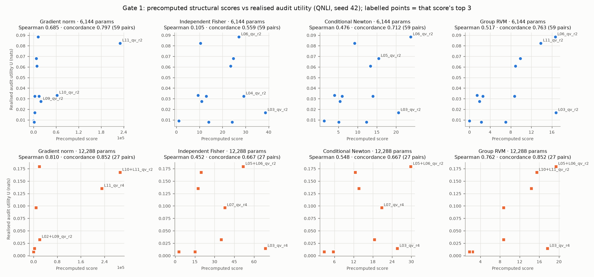
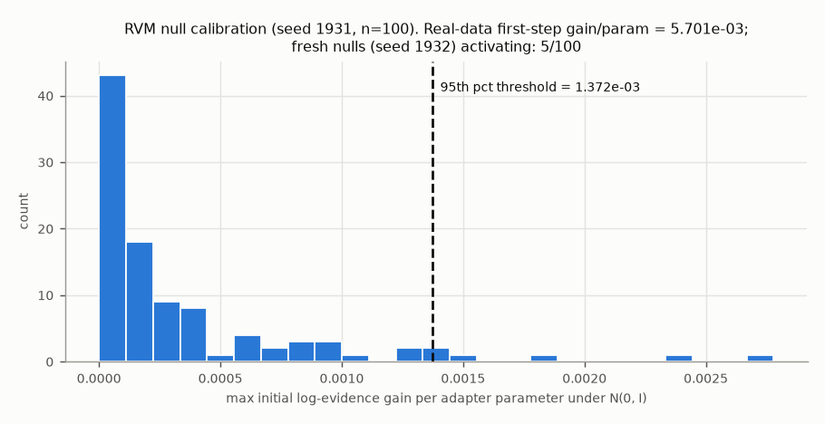

# RVM-LoRA pilot: final Go/No-Go assessment — corrected run `v2`

**Date:** 2026-10-18T06:14:03+00:00 (UTC)  
**Overall decision (machine-evaluated, `reports/v2/gates.json`):** **NO_GO**  
**Gate 0:** PASS · **Gate 1:** FAIL · **Gate 2:** NOT_RUN_GATE_FAILURE  
**Git SHA (report build):** `7b8b6de639f3ed1639dd8f08ebcc38da21fad6fd` · **Protocol freeze git SHA:** `d1aa145f3f35091afec68d5c53a628a03d9df158`  
**Protocol YAML SHA256:** `d242007e14950316549f7278cd7bdc2bd091bae577510ffdd5111b6bdf9b2b05` · **uv.lock SHA256:** `dd27a90b3e5e34e3bc11475da7a1b8ee41eeb871f9c3c26346cde36898cb38f5`  
**MLflow tracking URI:** remote-local `http://127.0.0.1:5000` (SQLite `mlruns/mlflow.db`, artifacts `mlruns/artifacts`), UI only through `ssh -N -L 15000:127.0.0.1:5000 <host>`  
**MLflow experiments:** `rvm-lora/gate0`, `rvm-lora/gate1`, `rvm-lora/gate2` (run IDs in `reports/v2/run_index.csv` and below)

## Executive judgment

**Still no — decision unchanged: `NO_GO`** (Gate 0 PASS, Gate 1 FAIL, Gate 2 NOT_RUN_GATE_FAILURE). This is the corrected re-execution (`v2`) of the frozen protocol after a correctness audit (`reports/CORRECTNESS_AUDIT.md`). The audit found one material implementation defect: the RVM precision optimiser returned local optima of the Type-II evidence, under-scoring 3 of 20 Gate-1 architectures by 1.3–11.8 nats (A1). It also found one latent cache defect (A2). Both were repaired without touching any protocol file, threshold, dataset, model, architecture, seed or budget.

*Observed (v2):* RVM concordance 0.7907 (68/86) passes the absolute bar, but the raw gradient norm still ranks better (0.8140). The margin is -0.0233 against the required +0.05: **FAIL**. The six-choice top-3 margin is now +0.01179 nats (v1 +0.00405): **PASS**. Interaction signs are 1/3 (v1 0/3): **FAIL**. The null control gives 5/100: PASS. The head, probe features and all 20 trainings reproduced v1 bit-for-bit; only the three A1-affected RVM scores changed.

*Interpretation:* the repair removes part of v1's evidence against RVM. RVM now clearly beats conditional Newton (0.791 vs 0.698 concordance; 0.0915 vs 0.0773 nats top-3), and its top-3 picks realise more utility than any cheap score. It still fails two pre-registered conditions on valid measurements, so Gate 2 was not run and no Gate-2 number exists. Two protocol properties limit what this negative result means:

* The prescribed head warm start leaves a near-chance head (audit accuracy 0.502).
* RVM scores gradient-SVD atoms, while the random zero-update LoRA starts in a subspace capturing 0.36% of the gradient energy, against 96.7% for the scored atoms.

Recommendation unchanged: **stop** this pre-registered path. Any re-posed study must be registered separately.

## Experimental integrity and environment

| Evidence item | Value / hash | Verified? |
|---|---|---|
| Hardware GPU / VRAM / driver | NVIDIA RTX A4000, 16376 MiB, 595.71.05 | yes (`nvidia-smi`, torch) |
| OS / Python / torch / CUDA / Transformers / PEFT / MLflow | Ubuntu 26.04, kernel 7.0.0-15 / 3.11.17 / 2.14.1+cu130 / CUDA runtime 13.0 / 5.20.1 / 0.21.2 / 3.17.1; BF16 supported=True, BF16 fwd/bwd smoke=True | yes |
| Model ID and exact revision | `FacebookAI/roberta-base@e2da8e2f811d1448a5b465c236feacd80ffbac7b` | pinned in code |
| QNLI training/audit split hash | manifest `09cb486a77901636…`, adapter_train `880378c3ead20ded…`, audit `0d5f185a9e682abd…` | yes (tests) |
| SST2 training/audit split hash | manifest `dbd2d19ce993450f…`, adapter_train `b2dade8b65d6b8cb…`, audit `4303f6f54eea6c07…` | yes (tests) |
| Classifier-head checkpoint hashes per task/seed | qnli/42: `08d1ce5a251956c0…` | yes (hash re-checked on load) |
| Protocol freeze timestamp / git / YAML / MD | 2026-10-18T05:37:10+00:00 / `d1aa145f3f35091afec68d5c53a628a03d9df158` / `d242007e14950316…` / prereg `20aea8867ff1ae22…`, clarifications `52307892ade8f154…` | yes |
| Pilot run manager log and run index | `logs/pilot_v2.log` (compact copy in bundle), `reports/v2/run_index.csv` | yes |
| Evidence/calibration/official validation isolation | split tests (disjoint, train-only); audit read only after freeze and score precomputation in this namespace (v1 audit outcomes were already known); official validation read only in Gate 2 | yes |
| Parameter-count assertions, LoRA-only gradients | asserted per run (`assert_exact_layout`, head digest before/after training) | yes |
| Baseline fidelity and source commits | PEFT 0.21.2 EVA (native); OPLoRA = DPLoRA stage 1 `cjpark-ai/DPLoRA@6666d8bdb37ebd153a8916b0464c8a3878976aae` (MIT), exact ILP port | see C6 in `docs/PROTOCOL_CLARIFICATIONS.md` |

## Gate 0: numerical and pipeline correctness

| Required check | Tests | Measured | Status |
|---|---|---|---|
| gaussian_evidence_matches_direct | 2 | test_gradient_matches_finite_difference: max_abs_grad_err=4.215e-09; test_gram_evidence_matches_direct: E_at_upper_bound=1.776e-07, atol=1.000e-07, max_rel_err_evidence=8.348e-13, max_rel_err_increments=1.363e-13, rtol=0.000010 | **PASS** |
| singleton_analytic_solution | 1 | test_singleton_analytic_vs_numeric: cases=200, excluded_cases=95, max_abs_err=7.105e-15 | **PASS** |
| singleton_ranking_equivalence_q2_over_h | 1 | test_singleton_ranking_equals_q2_over_h: eligible_atoms=8, identical_ordering=True | **PASS** |
| conditional_group_evidence_equals_direct_difference | 2 | test_conditional_fixed_increment_equals_difference: max_rel_err=1.425e-13; test_degenerate_cases: duplicate_column_evidence=6.628950, zero_target_evidence=-6.152e-09 | **PASS** |
| selector_behaviour_and_null | 6 | test_null_behaviour: count=40, fresh_activations=1, threshold=0.001933; test_rvm_selects_signal_and_respects_constraints: selected_units=5, stop=null_threshold, threshold=0.001963 | **PASS** |
| logit_direction_jacobian_vs_jvp_fd | 3 | test_direction_gradient_matches_autograd: max_singular_value_err=5.551e-16; test_jacobian_matches_jvp_and_fd: columns=12, max_rel_err_vs_central_fd=3.064e-08, max_rel_err_vs_jvp=1.259e-15, threshold=0.001000 | **PASS** |
| exact_adapter_placement_and_param_counts | 5 | test_architecture_param_counts: q2_plus_v2=6144, q4_plus_v4=12288; test_uniform_budgets: B24=36864, B48=73728 | **PASS** |
| splits_disjoint_stable_no_validation | 4 | test_prepared_manifests_if_present: manifests_checked=['qnli', 'sst2']; test_split_sizes_disjoint_and_stable:  | **PASS** |
| gate_logic_and_reproducibility | 10 | pass/fail assertions | **PASS** |
| baselines_oplora_ilp_and_eva_budget | 3 | test_dp_matches_milp_full_size: cases=5, milp_assignment_agreement=5 | **PASS** |
| mlflow_idempotent_run_keys | 4 | test_mlflow_live_server: run_id=12aebf8cc1b04430ae194a10cd9d06b2, uri=http://127.0.0.1:5000 | **PASS** |
| cuda_smoke_two_steps_frozen_head | 3 | test_eva_budget_and_init: eva_max_rank=2, eva_modules=20, eva_params=36864, eva_rank_sum=24; test_real_model_jacobian_vs_jvp: max_rel_err_real_model_vs_jvp=0.000027; test_two_step_train_eval: eval_loss_smoke=0.696471, peak_gpu_memory_mb=981.625977, precision=bfloat16, train_wall_2steps_s=0.708848 | **PASS** |
| regression_A1_evidence_global_maximisation | 2 | test_optimizer_matches_dense_search_scale_disparate: c3_only_failures=1.000000, max_dense_minus_optimiser=5.964e-10, problems=40; test_optimizer_reaches_global_maximum_on_real_subproblems: problems=3 | **PASS** |
| regression_A2_cache_provenance_and_namespace_isolation | 8 | pass/fail assertions | **PASS** |

**Gate 0 determination:** PASS (56/56 tests; `artifacts/v2/gate0/gate0.json`, MLflow run `9416f1747e5d4a56b99e343c6a91d805`). v2 Gate 0 re-ran the full prescribed suite on commit `d1aa145`, including the live-MLflow round trip and the CUDA smoke tests. It added two regression checks for the repaired defects: A1, global maximisation on the three real sub-problems the v1 optimiser under-maximised plus randomised scale-disparate groups; and A2, cache provenance and namespace isolation.

## Gate 1: QNLI architecture oracle (20 full runs)

Each `U(A) = audit_CE(head only) − audit_CE(A)` uses the same frozen warm-started head (QNLI, seed 42) and the final 600-step checkpoint. All four scores were precomputed and logged (`artifacts/v2/gate1/precomputed_scores.json`, MLflow probe run) before the first audit label was read in this run namespace (the original run's audit outcomes were already known; see `reports/CORRECTNESS_AUDIT.md`).

Head-only audit CE: `0.690920654655885` nats.

| Architecture | Params | Grad norm | Indep. Fisher | Cond. Newton | Group RVM (log ev.) | Audit CE | Audit acc. | U (nats) | Status | MLflow run |
|---|---:|---:|---:|---:|---:|---:|---:|---:|---|---|
| L00_qv_r2 | 6,144 | 0.961 | 1.090 | 1.305 | -5.428e-10 | 0.68179 | 0.5880 | 0.00913 | COMPLETED | `b4bf4cab02d14c7887af14bf3a8dc307` |
| L01_qv_r2 | 6,144 | 263.737 | 13.994 | 5.069 | 2.296 | 0.68310 | 0.5713 | 0.00782 | COMPLETED | `d4c29ca1db854ee7b832f03051c3e78c` |
| L02_qv_r2 | 6,144 | 1102.398 | 24.219 | 12.275 | 7.005 | 0.68305 | 0.5640 | 0.00787 | COMPLETED | `70dde60fe0504ea2895707c0dbbfb9a2` |
| L03_qv_r2 | 6,144 | 3263.488 | 38.592 | 20.621 | 16.805 | 0.67394 | 0.6393 | 0.01698 | COMPLETED | `6a34b18bd0594e7c976fc1957fdd7c5f` |
| L04_qv_r2 | 6,144 | 3326.227 | 29.184 | 13.933 | 8.741 | 0.65845 | 0.7060 | 0.03247 | COMPLETED | `20c665aed9a743ff878e2cc5334b905f` |
| L05_qv_r2 | 6,144 | 6873.944 | 24.727 | 15.463 | 9.839 | 0.62287 | 0.7280 | 0.06806 | COMPLETED | `93415cadab124d64a45572a406c896f7` |
| L06_qv_r2 | 6,144 | 12100.766 | 27.117 | 23.817 | 16.646 | 0.60253 | 0.7433 | 0.08839 | COMPLETED | `d13b31462bc948a1a84cbe7aad1c9a38` |
| L07_qv_r2 | 6,144 | 8336.252 | 23.550 | 13.309 | 8.935 | 0.63021 | 0.6413 | 0.06071 | COMPLETED | `7f4aa7ab7eb3442e90c1711a984e3903` |
| L08_qv_r2 | 6,144 | 14596.510 | 12.988 | 5.972 | 2.602 | 0.65863 | 0.6520 | 0.03229 | COMPLETED | `74fefbdb2f454328aaeff44acfee1ff1` |
| L09_qv_r2 | 6,144 | 19078.849 | 10.898 | 5.392 | 1.912 | 0.66349 | 0.6440 | 0.02743 | COMPLETED | `1033c076a5794f3b8dfa7582b9e2ce26` |
| L10_qv_r2 | 6,144 | 62383.100 | 9.343 | 3.992 | 1.437 | 0.65770 | 0.6680 | 0.03322 | COMPLETED | `848bd9cf79a1484d90e5badfec12ae34` |
| L11_qv_r2 | 6,144 | 230388.080 | 10.425 | 9.226 | 13.850 | 0.60844 | 0.7213 | 0.08248 | COMPLETED | `84de9fafd2d24fa8a379727b08fc7898` |
| L00+L01_qv_r2 | 12,288 | 264.698 | 15.085 | 5.624 | 2.384 | 0.68291 | 0.5687 | 0.00802 | COMPLETED | `f86f2e1f5f4d4b20a000815d674ec121` |
| L00_qv_r4 | 12,288 | 1.065 | 2.897 | 2.816 | 1.795 | 0.68317 | 0.5667 | 0.00775 | COMPLETED | `2aaf32a1c4a04b80ac6d31a608ff327b` |
| L02+L09_qv_r2 | 12,288 | 20181.247 | 35.117 | 18.479 | 8.704 | 0.65841 | 0.6493 | 0.03251 | COMPLETED | `00122677bdf047c4ad3fb5aa1890ad38` |
| L03_qv_r4 | 12,288 | 3273.507 | 68.710 | 25.668 | 17.645 | 0.67654 | 0.6267 | 0.01438 | COMPLETED | `3ee2afba8b84475c8eb09082772ff7c2` |
| L05+L06_qv_r2 | 12,288 | 18974.710 | 51.844 | 29.840 | 19.397 | 0.51144 | 0.7707 | 0.17948 | COMPLETED | `447925c90818431ba1a956bae680d7e3` |
| L07_qv_r4 | 12,288 | 8421.513 | 37.778 | 20.733 | 8.719 | 0.59457 | 0.7120 | 0.09636 | COMPLETED | `5193d9aacc7442c3b35dad5a621a5504` |
| L10+L11_qv_r2 | 12,288 | 292771.180 | 19.767 | 12.470 | 15.447 | 0.52358 | 0.7480 | 0.16734 | COMPLETED | `b1c27d3956f44f4789175f2f4e16548c` |
| L11_qv_r4 | 12,288 | 231109.010 | 17.533 | 13.606 | 14.379 | 0.55560 | 0.7340 | 0.13532 | COMPLETED | `1181e3b4a5974f4ea1d99407cbbb7923` |

Full-precision values: `reports/v2/architecture_scores.csv`.

| Structural score | Pairwise concordance (concordant/informative) | Spearman 6,144 | Spearman 12,288 | Six-choice top-3 mean U | Margin vs best cheap (top-3) |
|---|---:|---:|---:|---:|---:|
| Gradient norm | 0.8140 (70/86) | 0.685 | 0.810 | 0.07972 | 0.00000 |
| Independent Fisher | 0.5930 (51/86) | 0.105 | 0.452 | 0.07134 | -0.00837 |
| Conditional Newton | 0.6977 (60/86) | 0.476 | 0.548 | 0.07727 | -0.00244 |
| Group RVM | 0.7907 (68/86) | 0.517 | 0.762 | 0.09151 | 0.01179 |

Top-3 choices per stratum: Gradient norm: 6,144 → L11_qv_r2, L10_qv_r2, L09_qv_r2; 12,288 → L10+L11_qv_r2, L11_qv_r4, L02+L09_qv_r2; Independent Fisher: 6,144 → L03_qv_r2, L04_qv_r2, L06_qv_r2; 12,288 → L03_qv_r4, L05+L06_qv_r2, L07_qv_r4; Conditional Newton: 6,144 → L06_qv_r2, L03_qv_r2, L05_qv_r2; 12,288 → L05+L06_qv_r2, L03_qv_r4, L07_qv_r4; Group RVM: 6,144 → L03_qv_r2, L06_qv_r2, L11_qv_r2; 12,288 → L05+L06_qv_r2, L03_qv_r4, L10+L11_qv_r2

**Interaction non-additivity (not raw evidence increments):**

| Layer pair | Realised U(i,j)−U(i)−U(j), nats | Predicted E(i,j)−E(i)−E(j), log evidence | Informative? | Correct sign? |
|---|---:|---:|---|---|
| L00+L01_qv_r2 | -0.00894062801500295 | 0.08756809606318416 | True | False |
| L05+L06_qv_r2 | 0.023034657627567068 | -7.087963337748736 | True | False |
| L10+L11_qv_r2 | 0.05164092556033528 | 0.1603506072082599 | True | True |
| L02+L09_qv_r2 | -0.0027912997555203933 | -0.21285576598817912 | False | n/a |

**Stopping/null:** threshold (95th percentile of 100 calibration nulls, seed 1931) = `0.0013718244091873446` log-evidence nats per adapter parameter; fresh-null activations (seed 1932) = **5/100**; on the real QNLI features RVM selected 4 of 24 rank units (stop: null_threshold), ranks `{"roberta.encoder.layer.11.attention.self.query": 2, "roberta.encoder.layer.4.attention.self.query": 1, "roberta.encoder.layer.6.attention.self.query": 1}`.

**Gate-1 mandatory criteria** (thresholds from `configs/preregistered.yaml`):

| Criterion | Comparator | Cutoff | Actual (full precision) | Status |
|---|---|---|---|---|
| informative_cost_matched_pairs | >= | 30 | 86 | **PASS** |
| rvm_pairwise_concordance | >= | 0.65 | 0.7906976744186046 | **PASS** |
| rvm_concordance_minus_best_nonbayes | >= | 0.05 | -0.023255813953488413 | **FAIL** |
| rvm_six_choice_top3_utility_margin_nats | >= | 0.005 | 0.01179249304233021 | **PASS** |
| fresh_null_activations | <= | 10 | 5 | **PASS** |
| nonadditivity_sign_correct | >= | 3 | 1 | **FAIL** |

**Gate 1: FAIL.** Criteria 1b and 4 FAIL; 1a, 2 and 3 PASS. Relative to v1:

* Criterion 2 changes from FAIL to PASS. The corrected evidence moves L11_qv_r2 (U=0.0825) and L10+L11_qv_r2 (U=0.1673) into the RVM top-3, replacing L05_qv_r2 and L11_qv_r4.
* Criterion 1b improves from -0.1047 to -0.0233 but remains far from +0.05.
* Criterion 4 improves from 0/3 to 1/3. L10+L11 is now correct (I_evidence +0.160); L00+L01 and L05+L06 remain wrong.

Every other input is bit-identical to v1: U, head, features, and the gradient-norm, Fisher and Newton scores. The unchanged evaluator applied the unchanged YAML thresholds. This is a post-hoc corrected re-evaluation made after v1's audit outcomes were known (`reports/CORRECTNESS_AUDIT.md` §6).






## Gate 2: matched-budget comparisons

**Gate 2: NOT_RUN_GATE_FAILURE.** Gate 1 status FAIL; Gate 2 not run. Per the frozen conditional progression, none of the 24 Gate-2 trainings was started and the official GLUE validation splits were never evaluated. All 24 rows are listed with this status in `reports/v2/run_index.csv`; no Gate-2 number is reported or imputed.

| Method | Mean QNLI CE | Mean SST-2 CE | Mean accuracy | Actual LoRA params | Mean selection s | Mean adapter-train s | Peak GB |
|---|---:|---:|---:|---:|---:|---:|---:|
| uniform_r1 | NOT_RUN_GATE_FAILURE | NOT_RUN_GATE_FAILURE | — | — | — | — | — |
| eva | NOT_RUN_GATE_FAILURE | NOT_RUN_GATE_FAILURE | — | — | — | — | — |
| oplora | NOT_RUN_GATE_FAILURE | NOT_RUN_GATE_FAILURE | — | — | — | — | — |
| conditional_newton | NOT_RUN_GATE_FAILURE | NOT_RUN_GATE_FAILURE | — | — | — | — | — |
| group_rvm | NOT_RUN_GATE_FAILURE | NOT_RUN_GATE_FAILURE | — | — | — | — | — |
| uniform_r2 | NOT_RUN_GATE_FAILURE | NOT_RUN_GATE_FAILURE | — | — | — | — | — |

## Before/after comparison (original v1 → corrected `v2`)

| Quantity | Original v1 | Corrected | Equal? |
|---|---|---|---|
| Overall decision | NO_GO | NO_GO | yes |
| gate0 status | PASS | PASS | yes |
| gate1 status | FAIL | FAIL | yes |
| gate2 status | NOT_RUN_GATE_FAILURE | NOT_RUN_GATE_FAILURE | yes |
| Head checkpoint SHA256 | 08d1ce5a251956c08cea8736d3dc04ffbd7c2d439d80d97a53c1213c2e598034 | 08d1ce5a251956c08cea8736d3dc04ffbd7c2d439d80d97a53c1213c2e598034 | yes |
| Head train loss first20/last20 | 0.7267308056354522/0.6838110119104386 | 0.7267308056354522/0.6838110119104386 | yes |
| Head-only audit CE | 0.690920654655885 | 0.690920654655885 | yes |
| Head-only audit accuracy | 0.502 | 0.502 | yes |
| Gate-1 `informative_cost_matched_pairs` value | 86 | 86 | yes |
| Gate-1 `informative_cost_matched_pairs` status | PASS | PASS | yes |
| Gate-1 `rvm_pairwise_concordance` value | 0.7093023255813954 | 0.7906976744186046 | no |
| Gate-1 `rvm_pairwise_concordance` status | PASS | PASS | yes |
| Gate-1 `rvm_concordance_minus_best_nonbayes` value | -0.10465116279069764 | -0.023255813953488413 | no |
| Gate-1 `rvm_concordance_minus_best_nonbayes` status | FAIL | FAIL | yes |
| Gate-1 `rvm_six_choice_top3_utility_margin_nats` value | 0.004051394741717146 | 0.01179249304233021 | no |
| Gate-1 `rvm_six_choice_top3_utility_margin_nats` status | FAIL | PASS | no |
| Gate-1 `fresh_null_activations` value | 5 | 5 | yes |
| Gate-1 `fresh_null_activations` status | PASS | PASS | yes |
| Gate-1 `nonadditivity_sign_correct` value | 0 | 1 | no |
| Gate-1 `nonadditivity_sign_correct` status | FAIL | FAIL | yes |
| Gradient norm concordance | 0.813953488372093 (70/86) | 0.813953488372093 (70/86) | yes |
| Gradient norm top-3 mean U | 0.07971646781693296 | 0.07971646781693296 | yes |
| Gradient norm top-3 choices | {"12288": ["L10+L11_qv_r2", "L11_qv_r4", "L02+L09_qv_r2"], "6144": ["L11_qv_r2", "L10_qv_r2", "L09_qv_r2"]} | {"12288": ["L10+L11_qv_r2", "L11_qv_r4", "L02+L09_qv_r2"], "6144": ["L11_qv_r2", "L10_qv_r2", "L09_qv_r2"]} | yes |
| Independent Fisher concordance | 0.5930232558139535 (51/86) | 0.5930232558139535 (51/86) | yes |
| Independent Fisher top-3 mean U | 0.0713436165709063 | 0.0713436165709063 | yes |
| Independent Fisher top-3 choices | {"12288": ["L03_qv_r4", "L05+L06_qv_r2", "L07_qv_r4"], "6144": ["L03_qv_r2", "L04_qv_r2", "L06_qv_r2"]} | {"12288": ["L03_qv_r4", "L05+L06_qv_r2", "L07_qv_r4"], "6144": ["L03_qv_r2", "L04_qv_r2", "L06_qv_r2"]} | yes |
| Conditional Newton concordance | 0.6976744186046512 (60/86) | 0.6976744186046512 (60/86) | yes |
| Conditional Newton top-3 mean U | 0.07727410190645917 | 0.07727410190645917 | yes |
| Conditional Newton top-3 choices | {"12288": ["L05+L06_qv_r2", "L03_qv_r4", "L07_qv_r4"], "6144": ["L06_qv_r2", "L03_qv_r2", "L05_qv_r2"]} | {"12288": ["L05+L06_qv_r2", "L03_qv_r4", "L07_qv_r4"], "6144": ["L06_qv_r2", "L03_qv_r2", "L05_qv_r2"]} | yes |
| Group RVM concordance | 0.7093023255813954 (61/86) | 0.7906976744186046 (68/86) | no |
| Group RVM top-3 mean U | 0.08376786255865011 | 0.09150896085926317 | no |
| Group RVM top-3 choices | {"12288": ["L05+L06_qv_r2", "L03_qv_r4", "L11_qv_r4"], "6144": ["L03_qv_r2", "L06_qv_r2", "L05_qv_r2"]} | {"12288": ["L05+L06_qv_r2", "L03_qv_r4", "L10+L11_qv_r2"], "6144": ["L03_qv_r2", "L06_qv_r2", "L11_qv_r2"]} | no |
| L00+L01_qv_r2 I_oracle | -0.00894062801500295 | -0.00894062801500295 | yes |
| L00+L01_qv_r2 I_evidence (sign correct?) | 0.08756809606318416 (False) | 0.08756809606318416 (False) | yes |
| L05+L06_qv_r2 I_oracle | 0.023034657627567068 | 0.023034657627567068 | yes |
| L05+L06_qv_r2 I_evidence (sign correct?) | -7.087963337748736 (False) | -7.087963337748736 (False) | yes |
| L10+L11_qv_r2 I_oracle | 0.05164092556033528 | 0.05164092556033528 | yes |
| L10+L11_qv_r2 I_evidence (sign correct?) | -1.4368645403341302 (False) | 0.1603506072082599 (True) | no |
| L02+L09_qv_r2 I_oracle | -0.0027912997555203933 | -0.0027912997555203933 | yes |
| L02+L09_qv_r2 I_evidence (sign correct?) | -0.21285576598817912 (True) | -0.21285576598817912 (True) | yes |

| Architecture | U v1 | U corrected | RVM evidence v1 | RVM evidence corrected | Newton v1 | Newton corrected |
|---|---:|---:|---:|---:|---:|---:|
| L00_qv_r2 | 0.009131275263490446 | 0.009131275263490446 | -5.427702554650901e-10 | -5.427702554650901e-10 | 1.3050805044525018 | 1.3050805044525018 |
| L01_qv_r2 | 0.007824541093669257 | 0.007824541093669257 | 2.296218850344358 | 2.296218850344358 | 5.069384358344365 | 5.069384358344365 |
| L02_qv_r2 | 0.007872225617854722 | 0.007872225617854722 | 7.0048325178317885 | 7.0048325178317885 | 12.275013999430803 | 12.275013999430803 |
| L03_qv_r2 | 0.016978221412459416 | 0.016978221412459416 | 16.804978873300804 | 16.804978873300804 | 20.62060896864845 | 20.62060896864845 |
| L04_qv_r2 | 0.0324724713540534 | 0.0324724713540534 | 8.74081343604033 | 8.74081343604033 | 13.933032726419459 | 13.933032726419459 |
| L05_qv_r2 | 0.0680553833673706 | 0.0680553833673706 | 9.839043164304918 | 9.839043164304918 | 15.462618199230254 | 15.462618199230254 |
| L06_qv_r2 | 0.08839294593690383 | 0.08839294593690383 | 16.64637785713248 | 16.64637785713248 | 23.81733010253263 | 23.81733010253263 |
| L07_qv_r2 | 0.060713009676880536 | 0.060713009676880536 | 8.934842279740673 | 8.934842279740673 | 13.309198374650599 | 13.309198374650599 |
| L08_qv_r2 | 0.032285989731264064 | 0.032285989731264064 | 2.602492036276343 | 2.602492036276343 | 5.97224083124947 | 5.97224083124947 |
| L09_qv_r2 | 0.02742916603863188 | 0.02742916603863188 | 1.911835008885719 | 1.911835008885719 | 5.391726627418342 | 5.391726627418342 |
| L10_qv_r2 | 0.03322229031834034 | 0.03322229031834034 | 1.4368644844077991 | 1.4368644844077991 | 3.9917330756929643 | 3.9917330756929643 |
| L11_qv_r2 | 0.08247820001433925 | 0.08247820001433925 | 3.65318601207984 | 13.849842158973265 | 9.226444154812592 | 9.226444154812592 |
| L00_qv_r4 | 0.007748853537760225 | 0.007748853537760225 | 1.7945978371157043 | 1.7945978371157043 | 2.8163786638078268 | 2.8163786638078268 |
| L03_qv_r4 | 0.014379994967020138 | 0.014379994967020138 | 16.373104710084075 | 17.644929370925766 | 25.668213230050334 | 25.668213230050334 |
| L07_qv_r4 | 0.09635507882315952 | 0.09635507882315952 | 8.719424521201812 | 8.719424521201812 | 20.733009059110127 | 20.733009059110127 |
| L11_qv_r4 | 0.1353176427363052 | 0.1353176427363052 | 14.37898103419621 | 14.37898103419621 | 13.606300977270202 | 13.606300977270202 |
| L00+L01_qv_r2 | 0.008015188342156754 | 0.008015188342156754 | 2.383786945864772 | 2.383786945864772 | 5.623599782706818 | 5.623599782706818 |
| L05+L06_qv_r2 | 0.1794829869318415 | 0.1794829869318415 | 19.397457683688664 | 19.397457683688664 | 29.83991437416337 | 29.83991437416337 |
| L10+L11_qv_r2 | 0.16734141589301488 | 0.16734141589301488 | 3.653185956153509 | 15.447057250589324 | 12.469685258802805 | 12.469685258802805 |
| L02+L09_qv_r2 | 0.03251009190096621 | 0.03251009190096621 | 8.703811760729328 | 8.703811760729328 | 18.478805160649507 | 18.478805160649507 |

| Selector (QNLI/42, real features) | v1 | corrected |
|---|---|---|
| Group RVM ranks | `{"roberta.encoder.layer.10.attention.self.value": 1, "roberta.encoder.layer.3.attention.self.query": 2, "roberta.encoder.layer.4.attention.self.query": 1, "roberta.encoder.layer.6.attention.self.query": 1, "roberta.encoder.layer.7.attention.self.value": 1}` | `{"roberta.encoder.layer.11.attention.self.query": 2, "roberta.encoder.layer.4.attention.self.query": 1, "roberta.encoder.layer.6.attention.self.query": 1}` |
| Conditional Newton (B24) ranks | `{"roberta.encoder.layer.0.attention.self.value": 1, "roberta.encoder.layer.10.attention.self.value": 1, "roberta.encoder.layer.11.attention.self.value": 1, "roberta.encoder.layer.2.attention.self.value": 1, "roberta.encoder.layer.3.attention.self.query": 2, "roberta.encoder.layer.3.attention.self.value": 1, "roberta.encoder.layer.4.attention.self.query": 1, "roberta.encoder.layer.6.attention.self.query": 5, "roberta.encoder.layer.6.attention.self.value": 2, "roberta.encoder.layer.7.attention.self.query": 1, "roberta.encoder.layer.7.attention.self.value": 3, "roberta.encoder.layer.9.attention.self.query": 3, "roberta.encoder.layer.9.attention.self.value": 2}` | `{"roberta.encoder.layer.0.attention.self.value": 1, "roberta.encoder.layer.10.attention.self.value": 1, "roberta.encoder.layer.11.attention.self.value": 1, "roberta.encoder.layer.2.attention.self.value": 1, "roberta.encoder.layer.3.attention.self.query": 2, "roberta.encoder.layer.3.attention.self.value": 1, "roberta.encoder.layer.4.attention.self.query": 1, "roberta.encoder.layer.6.attention.self.query": 5, "roberta.encoder.layer.6.attention.self.value": 2, "roberta.encoder.layer.7.attention.self.query": 1, "roberta.encoder.layer.7.attention.self.value": 3, "roberta.encoder.layer.9.attention.self.query": 3, "roberta.encoder.layer.9.attention.self.value": 2}` |
| No-logdet ablation ranks | `{"roberta.encoder.layer.11.attention.self.query": 2, "roberta.encoder.layer.3.attention.self.query": 2, "roberta.encoder.layer.6.attention.self.query": 1, "roberta.encoder.layer.6.attention.self.value": 1}` | `{"roberta.encoder.layer.11.attention.self.query": 2, "roberta.encoder.layer.3.attention.self.query": 2, "roberta.encoder.layer.6.attention.self.query": 1, "roberta.encoder.layer.6.attention.self.value": 1}` |
| Newton with own null threshold (diagnostic) | `{"roberta.encoder.layer.10.attention.self.value": 1, "roberta.encoder.layer.3.attention.self.query": 2, "roberta.encoder.layer.4.attention.self.query": 1, "roberta.encoder.layer.6.attention.self.query": 1, "roberta.encoder.layer.7.attention.self.value": 1}` | `{"roberta.encoder.layer.10.attention.self.value": 1, "roberta.encoder.layer.3.attention.self.query": 2, "roberta.encoder.layer.4.attention.self.query": 1, "roberta.encoder.layer.6.attention.self.query": 1, "roberta.encoder.layer.7.attention.self.value": 1}` |
| RVM null threshold (nats/param) | 0.0013718244091873446 | 0.0013718244091873446 |
| RVM fresh-null activations | 5 | 5 |
| Thresholded Newton == RVM | True | False |

Every row is read from the v1 (`reports/`, `artifacts/`) and v2 (`reports/v2/`, `artifacts/v2/`) artifact trees. Only RVM-dependent quantities changed. Every U value, the head, the probe features and the three non-Bayesian scores are bit-identical (`reports/audit/v1_v2_comparison.json`).

## Failure analysis / critical ablations

| Probe | Selector | Rank units | Structure (module: rank) | Stop |
|---|---|---:|---|---|
| qnli_s42 | Group RVM | 4 | L4Q:1, L6Q:1, L11Q:2 | null_threshold |
| qnli_s42 | Conditional Newton (B24) | 24 | L0V:1, L2V:1, L3Q:2, L3V:1, L4Q:1, L6Q:5, L6V:2, L7Q:1, L7V:3, L9Q:3, L9V:2, L10V:1, L11V:1 | budget_exhausted |
| qnli_s42 | RVM no-logdet (offline ablation) | 6 | L3Q:2, L6Q:1, L6V:1, L11Q:2 | null_threshold |
| qnli_s42 | Newton with own null threshold (diagnostic) | 6 | L3Q:2, L4Q:1, L6Q:1, L7V:1, L10V:1 | threshold 0.0022763622904370616 |
| qnli_s42 | OPLoRA stage 1 | 24 | L2V:7, L10V:8, L11Q:1, L11V:8 | ILP |
| qnli_s42 | identity checks | — | RVM == Newton: False; no-logdet == Newton: False | λ = 0.01 |

All items below are **exploratory, post hoc** and feed no gate. Sources: `reports/v2/exploratory_diagnostics.json`, `reports/audit/*.json`.

* **Bayesian evidence vs regularised Newton (Gate-1 scores):** both use the same Φ, t and quadratic surrogate; only the ARD precisions and log-determinant (RVM) differ from a fixed ridge λ=0.01 (Newton). RVM leads by +0.093 concordance and +0.0142 nats top-3, which is attributable to the evidence term. The un-normalised gradient norm still has the highest concordance (0.814).
* **Selection and stopping (real QNLI/42 features):**
    * RVM selects L4Q:1, L6Q:1, L11Q:2 (null-threshold stop).
    * Null-thresholded Newton selects L3Q:2, L4Q:1, L6Q:1, L7V:1, L10V:1.
    * The no-logdet ablation selects L3Q:2, L6Q:1, L6V:1, L11Q:2.
    * Newton fills B24.

    The v1 observation that thresholded Newton reproduces RVM's exact structure was an artefact of A1. In v2 the evidence changes the selected structure relative to a null-thresholded ridge selector. Whether any of these sparse structures trains better at equal budget was not measured (Gate 2 not run).
* **Scale:** Spearman(U, mean feature-column norm) is 0.685 (6,144) and 0.905 (12,288). For the scale-free summed q²/h it is 0.182 and 0.452. At the corrected optima, 12 value and 0 query modules sit at the exclusion bound (v1: 14 and 1; some v1 exclusions, e.g. L11 value in L11_qv_r2, were local-optimum artefacts).
* **Interactions:** the realised (5,6) synergy is predicted as strong redundancy by both local surrogates (RVM -7.09). Conditional Newton's signs would score 1/3 (only L00+L01); RVM's v2 signs score 1/3.
* **Head and evidence/LoRA mismatch:** see `reports/CORRECTNESS_AUDIT.md` §3–§4. The head is bit-identical to v1 and near chance. The random zero-update LoRA tangent captures 0.36% of the direction-set gradient energy, against 96.7% for the scored gradient-SVD prefixes.
* **Exploratory SVD-aligned initialisation** (20 extra trainings outside the corrected run; MLflow experiment `rvm-lora/exploratory-svd-init`; not a protocol result). Recipe: identical training, but `A` set to the scored gradient-SVD right singular vectors at Kaiming row norms, with `B=0` (zero initial update verified for all 20).
    * Mean U rose from 0.0554 (random init) to 0.1278 nats.
    * Against these utilities: RVM concordance 0.692, gradient norm 0.703, Newton 0.758, Fisher 0.681.
    * Top-3 mean U: RVM 0.1561, gradient norm 0.1550.
    * Interaction signs: 1 of 4 informative effects correct.

    Details are in `reports/CORRECTNESS_AUDIT.md` §8. This changes no verdict.

## Resource accounting

- Completed main adapter trainings: 20 (Gate 1: 20, Gate 2: 0); summed 600-step training wall time 779.0 s = 0.216 GPU-hours (sequential, one GPU job at a time).
- Peak CUDA allocation across runs: 950 MB; training precision BF16 autocast, evaluation FP32 (TF32 disabled), selection linear algebra float64 on CPU.
- QNLI/42 head warm start: 5.5 s (excluded from the overhead ratio).
- OOM fallbacks: 0 runs used microbatch 4 × 8.
- QNLI/42 probe: direction pass 21.62 s, feature pass 2.92 s, OPLoRA importance pass 5.80 s, selection subprocess 22.99 s (start-up 0.44 s); RVM selection cost as charged 35.50 s, Newton 25.06 s, OPLoRA 5.81 s.

* The repaired evidence optimiser raises the RVM selection cost charged on QNLI/42 from 28.7 s to 35.5 s; the CPU selection subprocess takes 23.0 s instead of 7.9 s on 8 workers. It would matter only for the Gate-2 overhead criterion, which was not evaluated.
* The 20 v2 trainings are bit-identical to v1. The exploratory SVD-init check used 20 further trainings in its own MLflow experiment, outside the corrected run's 44-run budget.

## Deviations, missing evidence, and limitations

* **Code after the v1 freeze:**
    * `d1aa145`: repairs A1 (evidence optimiser) and A2 (cache provenance, `RVM_RUN_NAMESPACE`), plus regression tests.
    * `4d4a6fb`: fixes a string-concatenation bug in the new namespaced report section and adds audit scripts.
    * Later commits: report and audit documents only.

  The v2 freeze (`reports/v2/protocol_freeze.json`, git `d1aa145`) records the original freeze (git `7eb7092`), identical YAML, PREREG, C-doc and METHODS hashes, identical split manifests and an identical `uv.lock`.
* **C3 optimiser starts:** the three listed starts are kept. Further deterministic starts and a coordinate line search were added so that the pre-registered *maximised* evidence is reached (`reports/CORRECTNESS_AUDIT.md` A1).
* **Post-hoc correction:** v2's Gate-1 evaluation necessarily followed knowledge of v1's audit outcomes. The fix is an outcome-blind correctness rule, committed and verified before any corrected gate statistic was computed.
* **Report step:** the first v2 `all` invocation wrote `reports/v2/gates.json`, then exited with code 1 in the report step because of that bug. The report was rebuilt with `cli report` from the same artifacts.
* **Shared inputs:** the deterministic prepared split encodings in `data/` were shared with v1; their manifests are hash-identical.
* **Not executed:** all 24 Gate-2 runs (`NOT_RUN_GATE_FAILURE`). EVA and OPLoRA training therefore remain unverified in execution (unit-tested only).

## Final decision and next experiment

**Machine-evaluated decision:** `NO_GO` (from `reports/v2/gates.json`).  
**Scientific interpretation:** the corrected run confirms `NO_GO` under the frozen rules. Bayesian group evidence now predicts useful capacity better than its direct non-Bayesian analogue (conditional Newton), and its top-3 choices realise the most utility. It still fails two pre-registered conditions: it does not out-rank the raw gradient norm by the required concordance margin, and it mispredicts most non-additivity signs. The correction changes the reasons and the strength of the negative result, not the decision.

**Limits on interpretation:** a near-chance warm-started head; a structural gap between the scored gradient-SVD subspace and the randomly initialised LoRA subspace; one task and one seed; and a post-hoc corrected evaluation. No further tuning on these audit results is permitted. A re-posed protocol (e.g. a competent head or an evidence-aligned initialisation) would be a new, separately registered exploratory study.

## Reproduction and evidence index

- `configs/preregistered.yaml` SHA256 `d242007e14950316549f7278cd7bdc2bd091bae577510ffdd5111b6bdf9b2b05`; `docs/PREREGISTRATION.md` SHA256 `20aea8867ff1ae22433fd33e1691cc39e60daffee2cd92b5110b1393eaad926f`; freeze record `reports/v2/protocol_freeze.json`.
- MLflow run IDs: `reports/v2/run_index.csv` (column `mlflow_run_id`) and the tables above.
- `reports/v2/gates.json` (mechanical evaluator output), `reports/v2/run_index.csv`, `reports/v2/architecture_scores.csv`, `reports/v2/gate1_summary.csv`, `reports/v2/figures/`.
- Exact shell commands (fresh checkout on the GPU host):

```bash
bash scripts/bootstrap_remote.sh            # uv, Python 3.11, uv sync --frozen, dry run
bash scripts/start_mlflow.sh                # MLflow on 127.0.0.1:5000 in tmux 'rvm_mlflow'
export MLFLOW_TRACKING_URI=http://127.0.0.1:5000
uv run --frozen python -m rvm_lora.cli env-check
uv run --frozen pytest -q -m 'not post_hoc'
export RVM_RUN_NAMESPACE=v2            # isolated, versioned outputs
tmux new-session -d -s rvm_pilot 'bash scripts/run_remote.sh'   # full frozen gate chain
uv run --frozen python -m rvm_lora.cli status
uv run --frozen python -m rvm_lora.cli report   # gates.json, CSVs, figures, FINAL_REPORT.md, bundle
uv run --frozen pytest -q -m post_hoc           # gates.json reproducible from logged artifacts
```
- Review bundle: `reports/v2/review_bundle.zip`; its SHA256 is in `reports/v2/review_bundle.sha256` (the bundle contains this report, so the hash cannot be embedded here). Retrieve from the GPU host with `scp <user>@<host>:<REMOTE_PROJECT_DIR>/reports/v2/review_bundle.zip .`

## Appendix: all planned main runs

| Gate | Method | Task | Seed | Architecture | Status | Params | Eval CE | MLflow run |
|---|---|---|---|---|---|---:|---:|---|
| gate1 | fixed_architecture | qnli | 42 | L00_qv_r2 | COMPLETED | 6,144 | 0.68179 | b4bf4cab02d14c7887af14bf3a8dc307 |
| gate1 | fixed_architecture | qnli | 42 | L01_qv_r2 | COMPLETED | 6,144 | 0.68310 | d4c29ca1db854ee7b832f03051c3e78c |
| gate1 | fixed_architecture | qnli | 42 | L02_qv_r2 | COMPLETED | 6,144 | 0.68305 | 70dde60fe0504ea2895707c0dbbfb9a2 |
| gate1 | fixed_architecture | qnli | 42 | L03_qv_r2 | COMPLETED | 6,144 | 0.67394 | 6a34b18bd0594e7c976fc1957fdd7c5f |
| gate1 | fixed_architecture | qnli | 42 | L04_qv_r2 | COMPLETED | 6,144 | 0.65845 | 20c665aed9a743ff878e2cc5334b905f |
| gate1 | fixed_architecture | qnli | 42 | L05_qv_r2 | COMPLETED | 6,144 | 0.62287 | 93415cadab124d64a45572a406c896f7 |
| gate1 | fixed_architecture | qnli | 42 | L06_qv_r2 | COMPLETED | 6,144 | 0.60253 | d13b31462bc948a1a84cbe7aad1c9a38 |
| gate1 | fixed_architecture | qnli | 42 | L07_qv_r2 | COMPLETED | 6,144 | 0.63021 | 7f4aa7ab7eb3442e90c1711a984e3903 |
| gate1 | fixed_architecture | qnli | 42 | L08_qv_r2 | COMPLETED | 6,144 | 0.65863 | 74fefbdb2f454328aaeff44acfee1ff1 |
| gate1 | fixed_architecture | qnli | 42 | L09_qv_r2 | COMPLETED | 6,144 | 0.66349 | 1033c076a5794f3b8dfa7582b9e2ce26 |
| gate1 | fixed_architecture | qnli | 42 | L10_qv_r2 | COMPLETED | 6,144 | 0.65770 | 848bd9cf79a1484d90e5badfec12ae34 |
| gate1 | fixed_architecture | qnli | 42 | L11_qv_r2 | COMPLETED | 6,144 | 0.60844 | 84de9fafd2d24fa8a379727b08fc7898 |
| gate1 | fixed_architecture | qnli | 42 | L00_qv_r4 | COMPLETED | 12,288 | 0.68317 | 2aaf32a1c4a04b80ac6d31a608ff327b |
| gate1 | fixed_architecture | qnli | 42 | L03_qv_r4 | COMPLETED | 12,288 | 0.67654 | 3ee2afba8b84475c8eb09082772ff7c2 |
| gate1 | fixed_architecture | qnli | 42 | L07_qv_r4 | COMPLETED | 12,288 | 0.59457 | 5193d9aacc7442c3b35dad5a621a5504 |
| gate1 | fixed_architecture | qnli | 42 | L11_qv_r4 | COMPLETED | 12,288 | 0.55560 | 1181e3b4a5974f4ea1d99407cbbb7923 |
| gate1 | fixed_architecture | qnli | 42 | L00+L01_qv_r2 | COMPLETED | 12,288 | 0.68291 | f86f2e1f5f4d4b20a000815d674ec121 |
| gate1 | fixed_architecture | qnli | 42 | L05+L06_qv_r2 | COMPLETED | 12,288 | 0.51144 | 447925c90818431ba1a956bae680d7e3 |
| gate1 | fixed_architecture | qnli | 42 | L10+L11_qv_r2 | COMPLETED | 12,288 | 0.52358 | b1c27d3956f44f4789175f2f4e16548c |
| gate1 | fixed_architecture | qnli | 42 | L02+L09_qv_r2 | COMPLETED | 12,288 | 0.65841 | 00122677bdf047c4ad3fb5aa1890ad38 |
| gate2 | uniform_r1 | qnli | 42 | uniform_r1 | NOT_RUN_GATE_FAILURE | — | — | — |
| gate2 | eva | qnli | 42 | eva | NOT_RUN_GATE_FAILURE | — | — | — |
| gate2 | oplora | qnli | 42 | oplora | NOT_RUN_GATE_FAILURE | — | — | — |
| gate2 | conditional_newton | qnli | 42 | conditional_newton | NOT_RUN_GATE_FAILURE | — | — | — |
| gate2 | group_rvm | qnli | 42 | group_rvm | NOT_RUN_GATE_FAILURE | — | — | — |
| gate2 | uniform_r2 | qnli | 42 | uniform_r2 | NOT_RUN_GATE_FAILURE | — | — | — |
| gate2 | uniform_r1 | qnli | 2025 | uniform_r1 | NOT_RUN_GATE_FAILURE | — | — | — |
| gate2 | eva | qnli | 2025 | eva | NOT_RUN_GATE_FAILURE | — | — | — |
| gate2 | oplora | qnli | 2025 | oplora | NOT_RUN_GATE_FAILURE | — | — | — |
| gate2 | conditional_newton | qnli | 2025 | conditional_newton | NOT_RUN_GATE_FAILURE | — | — | — |
| gate2 | group_rvm | qnli | 2025 | group_rvm | NOT_RUN_GATE_FAILURE | — | — | — |
| gate2 | uniform_r2 | qnli | 2025 | uniform_r2 | NOT_RUN_GATE_FAILURE | — | — | — |
| gate2 | uniform_r1 | sst2 | 42 | uniform_r1 | NOT_RUN_GATE_FAILURE | — | — | — |
| gate2 | eva | sst2 | 42 | eva | NOT_RUN_GATE_FAILURE | — | — | — |
| gate2 | oplora | sst2 | 42 | oplora | NOT_RUN_GATE_FAILURE | — | — | — |
| gate2 | conditional_newton | sst2 | 42 | conditional_newton | NOT_RUN_GATE_FAILURE | — | — | — |
| gate2 | group_rvm | sst2 | 42 | group_rvm | NOT_RUN_GATE_FAILURE | — | — | — |
| gate2 | uniform_r2 | sst2 | 42 | uniform_r2 | NOT_RUN_GATE_FAILURE | — | — | — |
| gate2 | uniform_r1 | sst2 | 2025 | uniform_r1 | NOT_RUN_GATE_FAILURE | — | — | — |
| gate2 | eva | sst2 | 2025 | eva | NOT_RUN_GATE_FAILURE | — | — | — |
| gate2 | oplora | sst2 | 2025 | oplora | NOT_RUN_GATE_FAILURE | — | — | — |
| gate2 | conditional_newton | sst2 | 2025 | conditional_newton | NOT_RUN_GATE_FAILURE | — | — | — |
| gate2 | group_rvm | sst2 | 2025 | group_rvm | NOT_RUN_GATE_FAILURE | — | — | — |
| gate2 | uniform_r2 | sst2 | 2025 | uniform_r2 | NOT_RUN_GATE_FAILURE | — | — | — |
